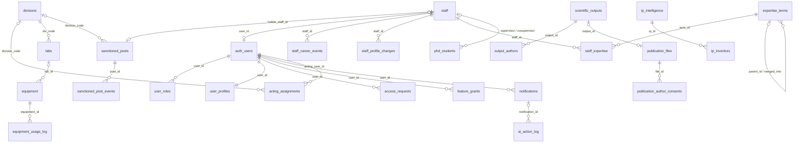
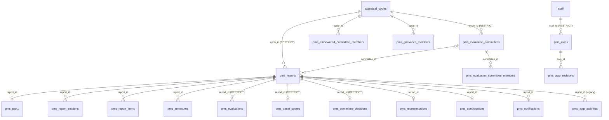
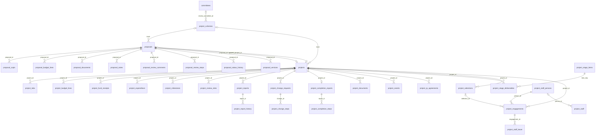
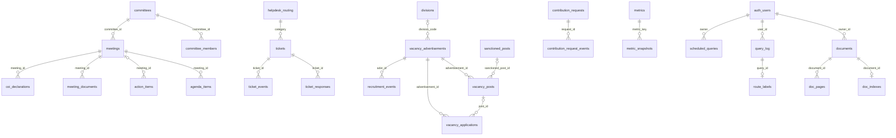

# SURYA — Database Design

_Consolidated checkpoint baseline: 2026-11-21 (8-file domain baseline `20261121000001`–`20261121000008`, 121 tables in `public`, 8 views, 310 functions, 77 triggers, 301 RLS policies across `public` and `storage.objects`, 7 private storage buckets, 6 sequences, 7 `pg_cron` jobs)._

> **Authoritative sources.** Physical schema and policies live in [supabase/migrations/](../../supabase/migrations/). Operational runbooks live in [supabase/ops/README.md](../../supabase/ops/README.md), workflow state machines in [system_design.md §4](system_design.md#4-state-machines), and PostgREST/RPC contracts in [api_spec.md](api_spec.md).

---

## 1. Conventions

- **Primary keys.** Native SURYA modules use `uuid DEFAULT gen_random_uuid()`. Legacy HR/spreadsheet tables retain quoted CamelCase string keys (`divisions."divCode"`, `staff."ID"`, `projects."ProjectID"`, `phd_students."EnrollmentNo"`, `equipment."UInsID"`, `contract_staff."id"`, `project_staff."id"`). Six append-only event/log tables use `bigint` sequence keys (`ai_action_log_id_seq`, `irins_sync_log_id_seq`, `project_events_id_seq`, `proposal_status_history_id_seq`, `recruitment_events_id_seq`, `sanctioned_post_events_id_seq`). Registry and reference catalogs use domain text codes (`project_schemes.code`, `metrics.key`, `project_stage_items.item_key`, `pms_pen_picture_items.item_key`, `feature_controls.feature_key`, `collection_indexes.collection_key`).
- **Timestamps and Indian Standard Time.** All timestamps are `timestamp with time zone DEFAULT now()`. Business-day checks run in IST via `ist_today()` (`(now() AT TIME ZONE 'Asia/Kolkata')::date`); Indian financial years (`YYYY-YY`, Apr–Mar) derive from `fiscal_year_of(date)`.
- **Row-Level Security and least-privilege ACLs.**
  - All **121** `public` tables have `ENABLE ROW LEVEL SECURITY` active (`283` policies in `public`, `18` policies on `storage.objects` = `301` policies).
  - Stage 01 (`20261121000001`) sets default privileges revoking `PUBLIC`/`anon` table, sequence, and function access and granting `authenticated`/`service_role` defaults without `TRUNCATE`, `TRIGGER`, or `REFERENCES`.
  - Stage 08 (`20261121000008`) narrows privileges explicitly:
    - **Column-narrowed writes (`UPDATE` restricted):** `user_profiles` (`active_role`, `last_seen_at`), `notifications` (`status`, `updated_at`), and `proposal_review_comments` (`resolved_at` only; table grant is `ardm` = SELECT/INSERT/DELETE/REFERENCES).
    - **Limited-command grants:** `user_roles` (`rm` — read/references only; role changes strictly via `admin_set_user_roles` / `approve_access_request`), `feature_grants` (`ardm` — no UPDATE), `scheduled_queries` (`ard` — owner read/insert/delete), `project_documents` (`arm` — append-only).
    - **RPC-only / trigger-only tables (`authenticated` has `SELECT` only, `r` or `rm`):** `acting_assignments`, `ai_action_log`, `audit_log`, `coi_declarations`, `contribution_requests`, `contribution_request_events`, `csir_rules`, `data_stewards`, `equipment_usage_log`, `ip_inventors`, `metric_snapshots`, `metrics`, `output_authors`, `pms_awps`, `pms_awp_revisions`, `pms_condonations`, `pms_panel_scores`, `pms_part1`, `pms_pen_picture_items`, `pms_report_items`, `project_budget_lines`, `project_change_requests`, `project_change_steps`, `project_completion_reports`, `project_completion_steps`, `project_engagements`, `project_events`, `project_expenditure`, `project_fund_receipts`, `project_ip_agreements`, `project_labs`, `project_milestones`, `project_review_slots`, `project_selections`, `project_staff_leave`, `project_staff_persons`, `project_stage_deliverables`, `project_stage_items`, `proposal_review_steps`, `proposal_versions`, `publication_files`, `publication_author_consents`, `recruitment_events`, `sanctioned_posts`, `sanctioned_post_events`, `staff_career_events`, `staff_profile_changes`, `tickets`, `ticket_responses`, `ticket_events`.
  - **Function execution boundary:** `40` internal/trigger/cron/retired functions have `EXECUTE` revoked from `PUBLIC` and `authenticated` and restricted to `service_role`. Every `SECURITY DEFINER` function pins `SET search_path = public` (or explicit schema) and opens with an authorization check, verified statically by `scripts/check_security_definer.py`.
- **No direct FKs on legacy HR names.** Because imported spreadsheets carry display names rather than IDs, legacy text columns (`"DivisionCode"`, `"PrincipalInvestigator"`, `"ProjectNo"`) are paired with resolved indexed keys (`pi_staff_id`, `supervisor_staff_id`, `cosupervisor_staff_id`, `project_id`) maintained automatically by database triggers.
- **Structural vs. operational seeds.** Five reference tables are populated by the consolidated baseline itself (`csir_rules`: 17 rows, `metrics`: 12 rows, `pms_pen_picture_items`: 15 rows, `project_schemes`: 4 rows, `project_stage_items`: 9 rows). Operational defaults live in `supabase/seed/` (`01_helpdesk_routing.sql`: 8 rows, `02_appraisal_cycle.sql`: 1 row).

---

## 2. Entity-Relationship Diagrams

### 2.1 Identity, RBAC & HR Workforce

### 2.2 PMS & Annual Work Plans

### 2.3 Projects, Proposals, Lifecycle (PL0–PL7) & Engagement

### 2.4 Committees, Operations, Metrics & RAG

---

## 3. Schema by Consolidated Baseline Stage

Notation: **PK** primary key · **FK** foreign key · **U** unique constraint/index · `?` nullable. All **121** tables are grouped below in exact migration creation order (`20261121000001`–`20261121000008`).

---

### 3.1 Extensions, Helpers & CSIR Rules — `20261121000001_extensions_helpers.sql` (1 table)

Installs `uuid-ossp`, `pgcrypto`, and `pg_cron`; establishes restrictive default ACLs; defines four foundational helpers (`ist_today()`, `person_name_key(text)`, `pms_set_updated_at()`, `set_updated_at()`); and creates the effective-dated institutional rule store:

- **`csir_rules`** (`RLS`, 1 SELECT policy; RPC-written via `csir_rule_set`, read by `csir_rule(key, on)`):
  `(id uuid PK, rule_key text, value jsonb, unit text?, effective_from date, effective_to date?, source_ref text, verified boolean DEFAULT false, note text?, created_by uuid? FK auth.users SET NULL, created_at timestamptz)`.
  **U** `(rule_key, effective_from)`. **CHECK:** non-blank `rule_key`/`source_ref`; `effective_to IS NULL OR effective_to >= effective_from`.
  Seeded with **17** initial CSIR/PMS rules (`verified = false`) covering major equipment threshold (₹5,00,000), RCE DG limit (20%), committee minutes windows, CPD half-yearly due dates, project-staff tenure/leave/relaxation/quorum limits, and PMS 2026 pay-level/committee-tier mappings.

---

### 3.2 Identity & RBAC — `20261121000002_auth_rbac.sql` (8 tables)

| Table | PK & Key Columns | Constraints, Indexes & Governance Notes |
|---|---|---|
| **`user_roles`** | **PK** `(user_id uuid FK auth.users CASCADE, role text)`, `division_code text?`, `must_change_password boolean DEFAULT true` | **CHECK** `role` ∈ 15 canonical roles (`Director`, `DivisionHead`, `Scientist`, `Technician`, `HRAdmin`, `FinanceAdmin`, `SystemAdmin`, `MasterAdmin`, `DefaultUser`, `HOD`, `Student`, `ProjectStaff`, `Guest`, `EmpoweredCommittee`, `PME`). **Index:** `(division_code)`. **Grant:** `rm` (SELECT/REFERENCES only); mutated exclusively via `admin_set_user_roles` / `approve_access_request`. |
| **`user_profiles`** | **PK** `user_id uuid FK auth.users CASCADE`, `email text?`, `must_change_password boolean DEFAULT true`, `active_role text?`, `last_seen_at timestamptz?`, `preferences jsonb DEFAULT '{}'`, `password_fingerprint text?` | **Trigger:** `trg_user_profiles_validate_active_role` validates `active_role` against `user_roles`; `handle_new_auth_user` (on `auth.users`) provisions `DefaultUser` + profile. **Grant:** `ardm` + column `UPDATE` restricted to `(active_role, last_seen_at)`. |
| **`acting_assignments`** | **PK** `id uuid`, `role text`, `division_code text? FK divisions SET NULL`, `principal_user_id uuid? FK auth.users SET NULL`, `acting_user_id uuid FK auth.users CASCADE`, `from_on date`, `to_on date`, `order_ref text`, `created_by uuid?`, `created_at timestamptz` | **CHECK:** `role` ∈ `HOD \| DivisionHead \| Director`; `(role = 'Director') = (division_code IS NULL)`; `to_on >= from_on`; non-blank `order_ref`. **Indexes:** `(acting_user_id, from_on, to_on)` + FK indexes. `SELECT`-only to clients; `caller_has_role()` / `caller_in_division()` honour active assignments. |
| **`access_requests`** | **PK** `id uuid`, `user_id uuid FK auth.users CASCADE`, `email text?`, `requested_roles text[]`, `requested_division text?`, `justification text`, `status text DEFAULT 'PENDING'`, `review_note text?`, `reviewed_by uuid?`, `reviewed_at timestamptz?`, `created_at timestamptz` | **CHECK:** `status` ∈ `PENDING \| APPROVED \| REJECTED`. **Partial unique:** `access_requests_one_pending (user_id) WHERE status = 'PENDING'`; partial pending queue index on `(created_at)`. |
| **`feature_controls`** | **PK** `feature_key text`, `enabled boolean DEFAULT true`, `disabled_roles text[] DEFAULT '{}'`, `note text?`, `updated_by uuid?`, `updated_at timestamptz` | `feature_key` matches `ACCESS_MAP` path. **Trigger:** `trg_feature_controls_updated_at`. Runtime kill-switch readable by all authenticated users, writable by MasterAdmin. |
| **`feature_grants`** | **PK** `(user_id uuid FK auth.users CASCADE, feature_key text)`, `note text?`, `granted_by uuid?`, `created_at timestamptz` | Per-user runtime access exception (`useAccess()` / `Access` management). **Grant:** `ardm` (no UPDATE). |
| **`notifications`** | **PK** `id uuid`, `user_id uuid FK auth.users CASCADE`, `kind text`, `severity text DEFAULT 'info'`, `title text`, `body text`, `link text?`, `source text DEFAULT 'rule'`, `dedupe_key text`, `status text DEFAULT 'open'`, `proposed_action jsonb?`, `created_at`, `updated_at` | **U** `(user_id, dedupe_key)`. **CHECK:** `severity` ∈ `info \| warning \| critical`; `source` ∈ `rule \| agent`; `status` ∈ `open \| read \| accepted \| dismissed`. **Indexes:** `(user_id, created_at DESC)`, partial open index. **Trigger:** `notifications_set_updated_at`. **Grant:** `r` + column `UPDATE` on `(status, updated_at)`. Agent suggestions accept atomically via `notification_accept`. |
| **`audit_log`** | **PK** `id uuid`, `entity_type text`, `entity_id uuid`, `action text`, `actor_id text`, `changes jsonb`, `created_at timestamptz` | **CHECK:** `entity_type` ∈ `committee \| meeting \| action_item \| ticket \| ticket_response \| calendar_event \| holiday`; `action` ∈ `created \| updated \| deleted \| status_changed`. **Indexes:** `(created_at DESC, id)`, `(created_at)`, `(entity_type, entity_id)`. Trigger-written, `SELECT`-only for admins. |

---

### 3.3 HR, Workforce, Facilities & Scientific Outputs — `20261121000003_hr_workforce.sql` (28 tables)

#### Core HR & Organisational Structure (10 tables)

- **`divisions`**: `"divCode" text PK`, `"divName"`, `"divDescription"`, `"divResearchAreas"`, `"divHoD"`, `"divHoDID"`, `"divSanctionedstrength" int`, `"divCurrentStrength" int`, `"divStatus"`. (Live UI computes sanctioned/filled/vacant counts dynamically from `division_strength` view.)
- **`staff`**: `"ID" text PK`, legacy CamelCase columns (`"LabCode"`, `"EmployeeType"`, `"Name"`, `"Designation"`, `"Group"`, `"Division"`, `"DoAPP"`, `"DOJ"`, `"DOB"`, `"Cat"`, `"AppointmentType"`, `"Level"`, `"CoreArea"`, `"Expertise"`, `"Email"`, `"Ext"`, `"VidwanID"`, `"ReportingID"`, `"HighestQualification"`, `"Gender"`) plus `user_id uuid? FK auth.users SET NULL`, `orcid text?`, and typed dates (`doj_date date?`, `dob_date date?`, `doapp_date date?`).
  - **Indexes:** `staff_division_idx`, `staff_email_lower_idx (lower("Email"))`, `staff_name_key_idx (person_name_key("Name"))`, partial `staff_reporting_id_idx`, partial unique `staff_user_id_key`.
  - **Triggers:** `trg_staff_typed_dates`, `trg_pms_awp_sync_staff_user`. **RLS:** `staff_select_own_supervisor` lets staff see their own reporting officer row too.
- **`sanctioned_posts`**: `id uuid PK`, `post_code text U`, `staff_group`, `level?`, `designation`, `discipline?`, `division_code? FK divisions SET NULL`, `category?`, `state` (`FILLED \| VACANT \| ADVERTISED \| ABEYANCE \| ABOLISHED`), `holder_staff_id? FK staff SET NULL`, `vacant_since date?`, `sanction_ref?`, `created_at`. **CHECK:** `(state = 'FILLED') = (holder_staff_id IS NOT NULL)`. **Partial unique:** `sanctioned_posts_one_post_per_holder`. RPC-only writes (`post_create/fill/vacate/set_state`).
- **`sanctioned_post_events`**: `id bigint PK` (`sanctioned_post_events_id_seq`), `post_id FK CASCADE`, `at`, `actor FK SET NULL`, `from_state?`, `to_state`, `staff_id?`, `effective_on?`, `order_ref?`, `note?`.
- **`staff_career_events`**: `id uuid PK`, `staff_id FK CASCADE`, `kind` (`APPOINTMENT \| PROMOTION \| TRANSFER \| DEPUTATION \| TRAINING \| ASSESSMENT \| RETIREMENT`), `effective_on date`, `detail jsonb`, `order_ref?`, `source` (`IMPORT \| MANUAL`), `created_by?`, `created_at`. **U** `(staff_id, kind, effective_on)`. Joins `entity_timeline`.
- **`staff_profile_changes`**: `id uuid PK`, `staff_id FK CASCADE`, `user_id?`, `changes jsonb`, `changed_at`. Written only by `update_own_profile` (whitelisted to `Expertise`, `CoreArea`, `Ext`, `orcid`, `VidwanID`). Joins `entity_timeline`.
- **`expertise_terms`**: `id uuid PK`, `label`, `kind` (`MATERIAL \| TECHNIQUE \| APPLICATION`), `theme_code` (`01`–`09`), `parent_id FK SET NULL`, `status` (`ACTIVE \| MERGED`), `merged_into FK SET NULL`, `created_by?`, `created_at`. **CHECK:** `(status = 'MERGED') = (merged_into IS NOT NULL)`. **Partial unique:** `expertise_terms_label_key` on `lower(btrim(label)) WHERE status = 'ACTIVE'`. Curated by HR/MasterAdmin/staff stewards.
- **`staff_expertise`**: **PK** `(staff_id FK CASCADE ON UPDATE CASCADE, term_id FK CASCADE)`, `source` (`SELF \| SUGGESTED`), `confirmed_at?`, `added_by DEFAULT auth.uid()`. Partial index on `term_id WHERE confirmed_at IS NOT NULL`.
- **`contract_staff`**: `"id" text PK`, `"Name"`, `"Designation"`, `"Division"`, `"DateOfJoining"`, `"ContractEndDate"`, `"LabCode"`, `"DateOfBirth"`, `"AttachedToStaffID"`, plus trigger-derived `joined_on`, `ends_on`, `born_on` (`trg_contract_staff_typed_dates`).
- **`phd_students`** & **`phd_milestones`**:
  - `phd_students`: `"EnrollmentNo" text PK`, `"StudentName"`, `"Specialization"`, `"SupervisorName"`, `"CoSupervisorName"`, `"FellowshipDetails"`, `"CurrentStatus"`, `"ThesisTitle"`, `"ProjectNo"`, `"DivisionCode"`, plus trigger-synced `supervisor_staff_id`, `cosupervisor_staff_id` (FK `staff`), `project_id` (FK `projects`).
  - `phd_milestones`: `id uuid PK`, `enrollment_no`, `milestone` (`Joining \| Coursework \| Comprehensive Exam \| Registration \| Synopsis Submission \| Thesis Submission \| Viva Voce \| Degree Awarded`), `due_date?`, `completed_date?`, `remarks?`, `created_at`. **U** `(enrollment_no, milestone)`.

#### Project Personnel & Scholars (4 tables)

- **`project_staff`**: `"id" text PK`, `"StaffName"`, `"Designation"`, `"RecruitmentCycle"`, `"DateOfJoining"`, `"DateOfProjectDuration"`, `"ProjectNo"`, `"PIName"`, `"DivisionCode"`, plus `staff_id FK staff SET NULL`, `project_id FK projects SET NULL`, `person_id FK project_staff_persons SET NULL`, and typed dates `joined_on`, `project_ends_on`. Triggers: `trg_project_staff_typed_dates`, `trg_project_staff_staff_key`, `trg_project_staff_project_key`.
- **`project_staff_persons`**: `id uuid PK`, `name`, `born_on?`, `category?` (`GEN \| SC \| ST \| OBC \| EWS \| PwBD`), `gender?`, `phd_registered_on?`, `thesis_submitted_on?`, `abroad_last_5y boolean DEFAULT false`, `antecedents_verified_on?`, `created_at`. **CHECK:** `thesis_submitted_on IS NULL OR phd_registered_on IS NOT NULL`.
- **`project_engagements`**: `id uuid PK`, `person_id FK CASCADE`, `project_id FK CASCADE`, `position_code`, `from_on date`, `to_on date` (`>= from_on`), `emoluments numeric(12,2)?`, `selection_id FK project_selections SET NULL`, `legacy_project_staff_id?`, `created_by?`, `created_at`. Created only after `project_engagement_check` passes all CSIR §3.3 rules.
- **`project_staff_leave`**: `id uuid PK`, `engagement_id FK CASCADE`, `kind` (`PAID \| MATERNITY \| PATERNITY \| OTHER`), `from_on date`, `to_on date`, `recorded_by?`, `recorded_at`.

#### Labs & Equipment (3 tables)

- **`labs`**: `id uuid PK`, `lab_code text U`, `lab_name`, `div_code FK divisions`, `created_at`.
- **`equipment`**: `"UInsID" text PK`, 11 legacy CamelCase columns (`"Name"`, `"EndUse"`, `"Division"`, `"IndenterName"`, `"OperatorName"`, `"Location"`, `"WorkingStatus"`, `"Movable"`, `"RequirementInstallation"`, `"Justification"`, `"Remark"`), plus `instrument_code`, `serial_number`, `manufacturer`, `year_of_manufacture int`, `lab_id FK labs`, `owner_user_id FK auth.users`, `amc_end_date date`, `purchase_cost numeric(14,2)`, `procurement_date date`, `project_id FK projects SET NULL`. Indexes on `owner_user_id`, `lab_id`, `amc_end_date`, `project_id`.
- **`equipment_usage_log`**: `id uuid PK`, `equipment_id FK CASCADE`, `used_on date`, `hours numeric(5,2)` (`0 < hours <= 24`), `user_staff_id? FK staff SET NULL`, `project_id? FK projects SET NULL`, `purpose` (non-blank), `logged_by FK auth.users`, `logged_at`. Append-only via `equipment_log_usage`.

#### Research Outputs, IP, Identity Links, IRINS, MoUs, Tech Transfers & Publication Clearance (11 tables)

- **`scientific_outputs`**: `id text PK`, `title`, `authors text[]`, `journal`, `year int`, `doi?`, `impact_factor float?`, `citation_count int?`, `division_code`, `project_id? FK projects SET NULL`. **Trigger:** `trg_scientific_outputs_authors` keeps `output_authors` in step.
- **`output_authors`**: **PK** `(output_id FK CASCADE, pos > 0)`, `author_name`, `staff_id? FK staff SET NULL`, `link_source` (`auto \| manual`), `confirmed_by?`, `confirmed_at?`.
- **`ip_intelligence`**: `id text PK`, `title`, `type` (`Patent \| Copyright \| Design \| Trademark`), `status` (`Filed \| Published \| Granted`), `filing_date text`, `grant_date text?`, `inventors text[]`, `division_code`, `project_id? FK projects SET NULL`. **Trigger:** `trg_ip_intelligence_inventors`.
- **`ip_inventors`**: **PK** `(ip_id FK CASCADE, pos > 0)`, `author_name`, `staff_id? FK staff SET NULL`, `link_source` (`auto \| manual`), `confirmed_by?`, `confirmed_at?`.
- **`irins_profiles`** & **`irins_sync_log`**: Cached Vidwan researcher JSON (`vidwan_id text PK`, `profile_data jsonb`, `synced_at`) and sync run ledger (`id bigint PK` via `irins_sync_log_id_seq`, `triggered_by`, `started_at`, `completed_at?`, `status`, `total_scientists`, `succeeded`, `failed`, `error_details jsonb?`).
- **`mous`**: `id uuid PK`, `partner_name`, `partner_type` (`Academic \| Industry \| Government \| International \| Other`), `purpose`, `signed_date?`, `valid_until?`, `status` (`Active \| Expired \| Under Renewal \| Terminated`), `division_code?`, `linked_project_no?`, `remarks?`, `project_id? FK projects SET NULL`, `created_at`, `updated_at`. Indexes on `status`, `valid_until`, `project_id`.
- **`tech_transfers`**: `id uuid PK`, `technology_title`, `licensee`, `licensee_type` (`Industry \| Startup \| PSU \| Government \| Other`), `agreement_type` (`License \| Know-how Transfer \| Joint Development \| Consultancy \| Sponsored`), `agreement_date?`, `value_lakhs numeric(12,2) >= 0`, `status` (`Under Negotiation \| Signed \| Active \| Completed \| Terminated`), `linked_project_no?`, `linked_ip_id?`, `division_code?`, `remarks?`, `project_id? FK projects SET NULL`, `created_at`, `updated_at`.
- **`publication_files`** & **`publication_author_consents`**: Pre-submission manuscript ethics/plagiarism workflow (`DRAFT → ETHICS_CHECK → CLEARED → SUBMITTED → ACCEPTED → PUBLISHED`). `publication_files` holds `id uuid PK`, `output_id? FK scientific_outputs SET NULL`, `title`, `division_code`, `communication_no text? U` (`AMPRI/<year>/<serial>`), `similarity_pct numeric(5,2)` (`0–100`), `similarity_report_document_id? FK documents SET NULL`, `journal?`, `year?`, `doi?`, `status`, `created_by`, `created_at`, `cleared_by?`, `cleared_at?`, `submitted_at?`, `published_at?`. `publication_author_consents` holds PK `(file_id FK CASCADE, pos > 0)`, `name`, `staff_id?`, `contribution?`, `consented_at?`.

---

### 3.4 PMS & Annual Work Plans — `20261121000004_pms_awp.sql` (21 tables)

| Table | Purpose, Keys & Invariants |
|---|---|
| **`appraisal_cycles`** | `(id uuid PK, name, start_date date, end_date date > start_date, status ∈ OPEN\|CLOSED\|ARCHIVED)`. **CHECK:** `EXTRACT(month FROM end_date) = 3` (March cycle end). **Partial unique:** at most one `OPEN` cycle. Four deadlines derive from `end_date` year (`SELF_APPRAISAL` May 15, `EC_COMPLETION` Jun 30, `EMPOWERED_COMPLETION` Jul 31, `SYSTEM_LOCK` Nov 30). |
| **`pms_reports`** | **U** `(cycle_id RESTRICT, scientist_id RESTRICT)`. Stores `status` (7 states), `track` (`STANDARD \| ANNEXURE_I \| ANNEXURE_II`, trigger-set from designation), `proforma_version` (`LEGACY \| 2026`), `questionnaire_b boolean`, `committee_id?`, `period_from/to`, `self_score` (`0–100`), `duty_days >= 0`, `score_communicated_at?` (anchors 15-day window), `deemed_accepted_at?`, `non_submission_certificate_path?`. **6 triggers** enforce track/questionnaire assignment, owner column guard, 2026 column lock, Nov 30 system lock (`trg_lock_pms_reports`), and `updated_at`. |
| **`pms_part1`** | **PK** `report_id FK CASCADE`, `data jsonb`, `prefilled_by?`, `prefilled_at?`, `discrepancy?`, `discrepancy_at?`, `verified_by?`, `verified_at?`. Establishment-verified Part I snapshot from HR data. Locked by `trg_lock_pms_part1`. |
| **`pms_report_sections`** | **U** `(report_id FK CASCADE, section_key)`. Flexible JSONB container per proforma section. Triggers: lock + `updated_at`. |
| **`pms_report_items`** | `id uuid PK`, **U** `(report_id FK CASCADE, section, source_record_type, source_record_id)`. `section` ∈ `PROJECT \| OUTPUT \| IP \| TECH_TRANSFER \| STUDENT \| COMMITTEE \| OTHER`; `state` ∈ `PREFILLED \| CONFIRMED \| EDITED \| ADDED \| REMOVED`; `link` CHECK `^(/\|https://)`. Non-owners see confirmed/edited/added items only. |
| **`pms_annexures`** | `id uuid PK`, `report_id FK CASCADE`, `file_name`, `file_path`, `file_size`, `mime_type`, `uploaded_at`. Points to private `annexures` bucket. |
| **`pms_evaluation_committees`** | `id uuid PK`, **U** `(name, cycle_id FK RESTRICT)`, `tier` (`I \| II \| III \| IV`). |
| **`pms_evaluation_committee_members`** | `id uuid PK`, **U** `(committee_id FK CASCADE, user_id FK RESTRICT)`, `role` (`REPORTING_OFFICER \| REVIEWING_OFFICER \| EC_MEMBER`). Panel validity checked by `pms_committee_panel_valid`. |
| **`pms_evaluations`** | `id uuid PK`, **U** `(report_id FK RESTRICT, evaluator_id FK RESTRICT)`, `status` (`PENDING \| IN_PROGRESS \| COMPLETED`), `scores jsonb`, `pen_picture jsonb`, `total_score 0–100`, `reasons_for_outstanding?`, `reasons_below_threshold?`, `suggestions_for_improvement?`. **5 triggers** enforce identity, lock, 2026 single-panel guard (`trg_pms_evaluations_guard_2026`), and automatic transition to `EMPOWERED_COMMITTEE_REVIEW` when the last legacy evaluation finishes. |
| **`pms_panel_scores`** | **PK** `report_id FK RESTRICT`, `committee_id`, `score 0–100`, reasons/suggestions, `pen_picture jsonb`, non-blank `integrity`, `adverse_remarks?`, `critical_assessment?`, `remarks?`, `quorum_present`, `members_total`, `signed_scan_path?`, `recorded_by`, `recorded_at`. 2026 single panel-score model (`pms_record_panel_score`). |
| **`pms_pen_picture_items`** | **PK** `item_key`, `group_code` (`A\|B\|C`), `group_name`, `label`, `sort smallint`. **Seeded with 15 behavioural items** (5 each in Groups A, B, C) verified against CSIR PMS 2026 Guidelines. |
| **`pms_empowered_committee_members`** | `id uuid PK`, **U** `(cycle_id FK CASCADE, user_id FK RESTRICT)`, `is_chairman boolean`. |
| **`pms_committee_decisions`** | `id uuid PK`, **U** `report_id FK RESTRICT`, `decided_by`, `final_score 0–100?`, `justification` (`>= 50` chars trimmed), `ec_action?` (`CONCUR \| UPGRADE \| DOWNGRADE`), `panel_score?`, `general_comments?`, `critical_assessment?`, `quorum_present?`, `members_total?`. Trigger `trg_pms_decisions_require_action` enforces `ec_action` on 2026 reports. |
| **`pms_representations`** | `id uuid PK`, **U** `report_id FK CASCADE`, `scientist_id FK RESTRICT`, `grounds` (`>= 20` chars trimmed), `status` (`PENDING \| RESOLVED`), `resolution?`, `resolved_by?`, `resolved_at?`. |
| **`pms_grievance_members`** | `id uuid PK`, **U** `(cycle_id FK CASCADE, user_id FK RESTRICT)`. |
| **`pms_condonations`** | **PK** `report_id FK CASCADE`, `condoned_until date`, `reason` (`>= 20` chars), `condoned_by`, `created_at`. |
| **`pms_notifications`** | `id uuid PK`, `user_id FK auth.users CASCADE`, `type`, `title`, `body`, `report_id? FK CASCADE`, `read boolean DEFAULT false`, `created_at`. Partial unread index on `(user_id, created_at DESC) WHERE NOT read`. |
| **`pms_audit_logs`** | `id uuid PK`, `user_id`, `action`, `entity_type`, `entity_id uuid`, `details jsonb`, `created_at`. Indexes on `(created_at DESC, id)`, `(entity_type, entity_id)`, `(user_id, created_at DESC)`. |
| **`pms_awps`** | `id uuid PK`, **U** `(staff_id FK staff RESTRICT, reporting_year ~ '^\d{4}-\d{2}$')`. `status` (`DRAFT \| WITH_RO \| WITH_RVO \| WITH_DIRECTOR \| RETURNED \| APPROVED`); JSONB sections (`part_a`, `activity_split`, `projects`, `objectives`, `development`); `reporting_officer_id`, `reviewing_officer_id`, verdicts/remarks, `source` (`ONLINE \| IMPORTED \| BLANK_FORWARDED`), `source_pdf_path`. Not subject to Nov 30 lock; confidential projects redacted server-side in `pms_awp_for_report()`. |
| **`pms_awp_activities`** | `id uuid PK`, `report_id FK CASCADE`, `nature_of_activity`, `role`, `time_committed_percentage 0–100`, `milestones jsonb`. Legacy in-report Part V storage retained for historical display. |
| **`pms_awp_revisions`** | `id uuid PK`, `awp_id FK CASCADE`, `initiated_by FK RESTRICT`, `reasons >= 20`, `before jsonb`, `after jsonb`, `status` (`PENDING \| APPROVED \| REJECTED`), `decided_by?`, `decided_at?`, `decision_remarks?`. |

---

### 3.5 Committees, COI & Helpdesk — `20261121000005_committees_helpdesk.sql` (11 tables)

- **`committees`**: `id uuid PK`, `name`, `committee_type` (`Standing \| AdHoc \| Review \| Advisory`), `mandate`, `chairperson_id`, `secretary_id`, `status` (`Active \| Inactive`), `formed_date date`, `confidentiality` (`institute \| members \| confidential`), `parent_committee_id?`, `rule_key?`, `sign_policy` (`CHAIR_SECRETARY \| ALL_PRESENT`), `dissolved_on?`, `dissolution_ref?`, `created_at`. Trigger `committees_audit`.
- **`committee_members`**: `id uuid PK`, `committee_id FK CASCADE`, `staff_id`, `role` (`Member \| Invitee \| ExternalExpert`).
- **`committee_terms`**, **`committee_memberships`**, **`external_members`**, **`committee_events`** (`20261121000010_committee_foundations.sql`): Term-scoped constitution (`term_no`, `from_on`, `to_on`, `quorum_min`, `quorum_needs_chair`, `cadence_months`, `status`), typed seats (`CHAIRPERSON \| MEMBER_SECRETARY \| CONVENER \| MEMBER \| EXTERNAL_EXPERT \| NOMINEE \| INVITEE`) synchronized back to `committees` via `trg_committee_memberships_sync_leads`, external member directory, and append-only `committee_events` (RPC-only insert).
- **`meetings`**: `id uuid PK`, `committee_id FK CASCADE`, `term_id? FK committee_terms`, `meeting_date date`, `meeting_no?`, `starts_at?`, `ends_at?`, `mode` (`IN_PERSON \| ONLINE \| HYBRID`), `venue`, `title`, `summary`, `stage` (11 states from `PLANNED` to `CONFIRMED` / `POSTPONED` / `CANCELLED` / `ADJOURNED`), `status` (`Scheduled \| Completed \| Cancelled`), `adjourned_from_id?`, `notice_days?`, `teams_url?`, `pamphlet_url?`, `created_at`. Triggers: `meetings_audit`, `trg_meetings_sync_status_from_stage`.
- **`agenda_items`**: `id uuid PK`, `meeting_id FK CASCADE`, `sequence int`, `item_type` (`CONFIRM_MINUTES \| ACTION_TAKEN \| DECISION \| INFORMATION \| OTHER`), `title`, `description`, `proposed_by`, `presenter_staff_id?`, `minutes_allotted?`, `proposal_state` (`PROPOSED \| ACCEPTED \| DECLINED`), `status` (`Pending \| Discussed \| Deferred`), `subject_type?` (`project_review \| proposal \| change_request \| completion_report \| action_item`), `subject_id?`. Partial index `(subject_type, subject_id)`.
- **`action_items`**: `id uuid PK`, `meeting_id? FK meetings SET NULL`, `agenda_item_id?`, `proceeding_id?`, `source` (`meeting \| manual`), `task`, `assigned_to`, `assigned_staff_id?`, `priority` (`LOW \| NORMAL \| HIGH \| URGENT`), `deadline date`, `status` (`Pending \| InProgress \| Completed \| Blocked \| Dropped \| Verified`), `verified_by?`, `verified_at?`, `extensions int`, `completed_at?`, `notes`. Triggers: `action_items_audit`, `trg_action_items_sync_staff_id`.
- **`meeting_documents`**: `id uuid PK`, `meeting_id FK CASCADE`, `agenda_item_id?`, `document_id? FK documents`, `file_name`, `storage_path`, `uploaded_at` (private `committee-docs` bucket).
- **Committee read RLS (`CM0`):** `committees`, `meetings`, `agenda_items`, `meeting_documents`, `committee_members`, `committee_terms`, `committee_memberships`, and `committee_events` enforce `committee_can_read(committee_id)`.
- **Rooms, Bookings, Hospitality, Common Desk & Role Home Foundations (`20261121000011_stage2_homes_desk_rooms.sql`):** Adds `equipment_in_charge`, `request_norms`, `request_catalog`, `calendar_tokens`, `rooms` (`kind` ∈ `'room' \| 'vehicle' \| 'guest house'`), `module_desks`, `room_bookings` (with `pg_advisory_xact_lock` overlap check), and `hospitality_requests`; extends `calendar_events` (`starts_at`, `ends_at`), `tickets` (`request_key`, `is_confidential`, `against_user_id`), and `project_staff_persons` (`user_id`); and ships `caller_division_codes()`, `division_rollup()`, `my_report_timers()`, `my_engagement()`, `my_day()`, `my_requests()`, `calendar_token_rotate()`, `room_book()`, `room_booking_decide()`, `meeting_schedule()`, `meeting_postpone()`, `hospitality_request_create()`, and `hospitality_request_decide()`.
- **`coi_declarations`**: `id uuid PK`, **U** `(meeting_id FK CASCADE, member_user_id FK auth.users CASCADE)`, `format` (`F1 \| F2`), `conflict_note?` (required when `format = 'F2'`), `chair_decision?` (`CONTINUE \| RECUSE`, NULL unless `F2`), `decided_by?`, `decided_at?`, `declared_at`. RPC-only writes (`coi_declare`, `coi_chair_decide`).
- **`tickets`**: `id uuid PK`, `token text U`, `subject`, `category` (8 categories), `urgency` (`Low \| Medium \| High \| Critical`), `description`, `submitted_by uuid FK RESTRICT`, `assigned_to? uuid FK SET NULL`, `status` (`Open \| InProgress \| Resolved \| Closed`), `created_at`, `updated_at`, `resolved_at?`. Triggers: `tickets_audit`, `trg_tickets_updated_at`.
- **`ticket_responses`**: `id uuid PK`, `ticket_id FK CASCADE`, `author_id uuid FK RESTRICT`, `message`, `created_at`. Trigger: `ticket_responses_audit`.
- **`ticket_events`**: `id uuid PK`, `ticket_id FK CASCADE`, `event_type` (`Created \| Assigned \| StatusChanged \| Resolved \| Closed \| Reopened`), `actor_id?`, `details jsonb`, `created_at`.
- **`helpdesk_routing`**: `id uuid PK`, `category text U`, `target_type` (`division \| role`), `target_id`. Seeded by `supabase/seed/01_helpdesk_routing.sql`.

---

### 3.6 Projects, Proposals & Lifecycle (PL0–PL7) — `20261121000006_projects_proposals_lifecycle.sql` (29 tables)

#### Schemes & Master Registries (2 tables)

- **`project_schemes`**: `code text PK`, `name`, `leader_user_id? FK auth.users SET NULL`, `review_committee_id? FK committees SET NULL`, `created_at`, `updated_at`. **Seeded with 4 tracks:** `ULIP`, `HQ`, `EFP`, `OLP`.
- **`projects`**: `"ProjectID" text PK`, 16 legacy CamelCase HR/finance columns (`"ProjectNo"`, `"ProjectName"`, `"FundType"`, `"SponsorerType"`, `"SponsorerName"`, `"ProjectCategory"`, `"ProjectStatus"`, `"StartDate"`, `"CompletioDate"` *(sic)*, `"SanctionedCost"`, `"UtilizedAmount"`, `"PrincipalInvestigator"`, `"DivisionCode"`, `"Extension"`, `"ApprovalAuthority"`), plus 14 typed/lifecycle columns: `pi_staff_id? FK staff SET NULL`, `stage?` (`SANCTIONED \| ACTIVE \| ON_HOLD \| CLOSING \| CLOSED \| ARCHIVED \| FORECLOSED`), `track? FK project_schemes`, `sanctioned_cost numeric?`, `start_date date?`, `end_date date?`, `proposal_id? FK proposals SET NULL` (partial unique when set), `sanction_ref?`, `sanction_date?`, `legacy_completed_at?`, `legacy_completed_by?`, `theme_code?` (`01`–`09`), `trl_target smallint?` (`1`–`9`), `trl_reached smallint?` (`1`–`9`).
  - **7 triggers:** `trg_projects_default_authority`, `trg_projects_derive_columns` (bidirectional `stage` ↔ `"ProjectStatus"` sync), `trg_projects_staff_key`, `trg_projects_resync_child_keys` (links child `project_id` iff `"ProjectNo"` is unique), `trg_projects_regenerate_slots`, `trg_projects_log`, and `trg_projects_zz_archived_readonly` (blocks all mutations after `ARCHIVED`).

#### Proposals & Pre-Sanction Chain PL1–PL2 (9 tables)

- **`proposals`**: `id uuid PK`, `proposal_code text U` (`proposals_set_code_trg`, SECURITY DEFINER), `title`, `acronym?`, classification (`domain_theme`, `fund_type`, `sponsor_type`, `sponsor_name`, `project_category`, `category_code` ∈ 9 CSIR codes, `track FK project_schemes`), nullable draft fields (`abstract`, `problem_statement`, `objectives`, `expected_outcomes`, `proposed_start_date`, `proposed_duration_months > 0`, `requested_budget >= 0`, `current_trl`, `target_trl`), people (`pi_user_id`, `pi_name`, `division_code`), workflow (`status` ∈ 10 values, `review_body?`, `review_sent_date?`, `revision_notes?`, `rejection_reason?`, `submitted_version_id?`), sanction (`sanctioned_amount?`, `sanction_date?`, `om_number?`, `om_date?`, `linked_project_no?`, `project_id? FK projects`, `parent_project_id? FK projects`, `archived boolean`), audit timestamps/actors.
- **`proposal_copis`**: **PK** `(proposal_id FK CASCADE, staff_id)`, `staff_name`.
- **`proposal_budget_lines`**: `id uuid PK`, `proposal_id FK CASCADE`, `fiscal_year` (`YYYY-YY`), `head` (`EQUIPMENT \| WORKS \| MANPOWER \| CONSUMABLES \| TA_INDIA \| TA_ABROAD \| CONTINGENCY \| OUTSOURCING \| OTHER`), `item`, `amount >= 0`, `created_at`. Trigger `trg_proposal_budget_lines_total` updates `proposals.requested_budget`.
- **`proposal_documents`**: `id uuid PK`, `proposal_id FK CASCADE`, `doc_type` (`signed_proposal \| om_document \| quotation \| step_scan \| sanction_order`), `storage_path`, `file_name`, `file_size`, `uploaded_at`, `uploaded_by`.
- **`proposal_notes`**: `id uuid PK`, `proposal_id FK CASCADE`, `author_id FK auth.users CASCADE`, `body` (non-blank), `used_in?` (`abstract \| problem_statement \| objectives \| expected_outcomes`), `used_at?`, timestamps. Author-only RLS (`Select`/`Insert`/`Update`/`Delete` — completely private, never shared).
- **`proposal_review_comments`**: `id uuid PK`, `proposal_id FK CASCADE`, `section` (`idea \| plan \| team \| budget \| documents`), `body`, `author_id`, `created_at`, `resolved_at?`. Reviewers insert/withdraw; PI may update `resolved_at` only.
- **`proposal_review_steps`**: `id uuid PK`, **U** `(proposal_id FK CASCADE, round, seq)`, `kind` (8 step kinds: `PME_VETTING`, `FINANCE`, `REVIEW_COMMITTEE`, `DIRECTOR_APPROVAL`, `DIRECTOR_FORWARD`, `HQ_SCREENING`, `HQ_EXPERT`, `COMPETENT_AUTHORITY`), `status` (`PENDING \| DONE \| RETURNED \| REJECTED \| SKIPPED`), `decided_by?`, `decided_at?`, `notes?`, `document_id? FK proposal_documents SET NULL`, `meeting_id? FK meetings SET NULL`.
- **`proposal_status_history`**: `id bigint PK` (`proposal_status_history_id_seq`), `proposal_id FK CASCADE`, `from_status?`, `to_status`, `payload jsonb?`, `changed_by`, `changed_at`.
- **`proposal_versions`**: `id uuid PK`, **U** `(proposal_id FK CASCADE, version_no)`, `label`, `kind` (`manual \| submitted`), `snapshot jsonb`, `created_by`, `created_at`.

#### Project Execution, Labs, Finances, Reviews, Changes, Closure & Stage Gates PL3–PL7 (18 tables)

| Table | Purpose, Keys & Invariants |
|---|---|
| **`project_labs`** | **PK** `(project_id FK CASCADE, lab_code ~ '^[A-Z][A-Z0-9-]{1,15}$')`, `role` (`NODAL \| PARTICIPATING`), `rc_approval_document_id? FK project_documents SET NULL`. **Partial unique:** `project_labs_one_nodal` (at most one `NODAL` lab per project). |
| **`project_budget_lines`** | `id uuid PK`, `project_id FK CASCADE`, `fiscal_year`, `head`, `item`, `amount` (`>= 0 OR change_request_id IS NOT NULL`), `source`, `change_request_id? FK project_change_requests`, `lab_code DEFAULT 'AMPRI'`. |
| **`project_fund_receipts`** | `id uuid PK`, `project_id FK CASCADE`, `received_on date`, `fiscal_year`, `amount <> 0`, `head?`, `source`, `order_no`, `order_date?`, `ifd_file_no?`, `ifd_date?`, `document_id? FK project_documents SET NULL`, `reverses_id? U` (self-FK), `opening_balance boolean`, `lab_code DEFAULT 'AMPRI'`. Append-only ledger (`project_reverse_entry` to reverse once); triggers copy `lab_code` on reversal and log to `project_events`. |
| **`project_expenditure`** | `id uuid PK`, `project_id FK CASCADE`, `fiscal_year`, `period` (`Q1–Q4 \| H1 \| H2 \| FY`), `head`, `amount <> 0`, `document_id?`, `reverses_id? U`, `opening_balance boolean`, `lab_code DEFAULT 'AMPRI'`. **3 triggers:** reversal lab sync, `project_events` logging, and `trg_project_expenditure_utilized` keeping `projects."UtilizedAmount"` in sync on sanctioned projects. |
| **`project_milestones`** | `id uuid PK`, `project_id FK CASCADE`, `title`, `target_date date`, `status` (`PROPOSED \| PLANNED \| REPORTED \| ACHIEVED \| DROPPED`), `achieved_on?`, `report_note?`, `document_id?`, `decision_note?`. |
| **`project_review_slots`** | `id uuid PK`, **U** `(project_id FK CASCADE, kind, period_end)`. `kind` ∈ 7 review/report types (`PROGRESS_REPORT`, `REVIEW_COMMITTEE`, `RESEARCH_COUNCIL`, `TASK_FORCE`, `MONITORING_COMMITTEE`, `STAGE_GATE`, `CALLED_REVIEW`); `decision` ∈ 8 decisions (`CONTINUE`, `CONTINUE_WITH_CHANGES`, `HOLD`, `FORECLOSURE_RECOMMENDED`, `GO`, `CONDITIONAL_GO`, `KILL`, `RECYCLE`); `status` (`PENDING \| DONE \| CANCELLED`); `minutes_days?`, `minutes_due?`, `minutes_document_id?`, `meeting_id?`, `report_id?`. Derived automatically by `project_generate_slots`. |
| **`project_reports`** & **`project_report_history`** | `project_reports`: `id uuid PK`, `project_no`, `project_name`, `division_code?`, `period_type` (`Q\|H\|Y`), `period_label`, `due_date?`, `status` (`DRAFT \| SUBMITTED \| UNDER_REVIEW \| REVISION_REQUESTED \| REVIEWED`), `project_id? FK projects SET NULL`, `slot_id? FK project_review_slots SET NULL`. Triggers link `project_id`, assign `slot_id`, and close the slot when submitted. `project_report_history`: `(id, report_id FK CASCADE, from_status?, to_status, payload jsonb, changed_by, changed_at)`. |
| **`project_change_requests`** & **`project_change_steps`** | Requests: `id uuid PK`, `project_id FK CASCADE`, `kind` (`TIME_OVERRUN \| RCE \| REPHASING \| REAPPROPRIATION \| REALLOCATION \| FORECLOSURE`), `status` (7 states), `round`, `justification`, `payload jsonb`, `increase_pct numeric(7,2)?`, `request_document_id?`, `order_no?`, `order_date?`, `ifd_file_no?`, `ifd_date?`, `decision_note?`. Steps: **U** `(change_id FK CASCADE, round, seq)`, `kind` (9 step types), `status` (5 states). Rules enforced via `project_change_deltas` & `csir_rules`. |
| **`project_completion_reports`** & **`project_completion_steps`** | Completion report: `id uuid PK`, **U** `project_id FK CASCADE`, `status` (`DRAFT \| SUBMITTED \| UNDER_REVIEW \| RETURNED \| APPROVED`), `round`, narrative lessons (`summary`, `objectives_status` ∈ `MET \| PARTLY_MET \| NOT_MET`, `objectives_reason`, `what_worked`, `what_did_not`, `reusable_assets`, `trl_target 1–9`, `trl_reached 1–9`, `recommendations`, `follow_on_ideas`), snapshotted `financial_statement jsonb`, `annexures jsonb`, `document_id?`, `published_document_id? FK documents SET NULL`. Steps: **U** `(report_id FK CASCADE, round, seq)`. |
| **`project_documents`** | `id uuid PK`, `project_id FK CASCADE`, `doc_type` (11 values: `receipt_order`, `expenditure_statement`, `milestone_evidence`, `minutes`, `change_request`, `change_order`, `completion_report`, `closure_order`, `sanction_order`, `stage_deliverable`, `other`), `storage_path`, `file_name`, `file_size`, `uploaded_by`. Stored in private bucket `project-documents`. |
| **`project_events`** | `id bigint PK` (`project_events_id_seq`), `project_id FK CASCADE`, `at`, `actor?`, `kind`, `summary`, `ref_id?`. Populated automatically by triggers across projects, receipts, expenditure, milestones, documents, review slots, changes, and closure. |
| **`project_ip_agreements`** | `id uuid PK`, `project_id FK CASCADE`, `document_id FK project_documents`, `signed_on date`, `recorded_by?`, `recorded_at` (CSIR §6.2 multi-lab IP agreement tracking). |
| **`project_selections`** | `id uuid PK`, `project_id FK CASCADE`, `position_code`, `mode` (`SELECTION \| WAITLIST \| DIRECT`), `advert_ncs_ref?`, `advert_on?`, `committee jsonb`, `exigency_note?`, `waitlist_valid_until?`, `minutes_document_id? FK project_documents SET NULL`. |
| **`project_stage_items`** & **`project_stage_deliverables`** | Reference catalog `project_stage_items` (**PK** `item_key`, `stage 1–6`, `label`, `sort` — **seeded with 9 FTT/FTC/MMP items across stages I–VI**) and per-project evidence `project_stage_deliverables` (**PK** `(project_id FK CASCADE, item_key FK project_stage_items)`, `document_id FK project_documents`). |

---

### 3.7 Calendar, Recruitment, Contribution Requests, Metrics & AI Actions — `20261121000007_calendar_recruitment_ops.sql` (16 tables)

- **Calendar (2 tables):**
  - **`calendar_events`**: `id uuid PK`, `title`, `event_date date`, `event_kind` (`Custom \| Pamphlet \| Announcement`), `location`, `teams_url?`, `pamphlet_url?`, `description`, `visibility` (`OrgWide \| Division \| Personal`), `division_code?`, `created_by`, timestamps. **CHECK:** `visibility <> 'Division' OR division_code IS NOT NULL`.
  - **`holidays`**: `id uuid PK`, **U** `(holiday_date date, name)`, `holiday_type` (`Gazetted \| Restricted \| Institute`), `year int`.
- **Recruitment (4 tables):**
  - **`vacancy_advertisements`**: `id text PK`, `title`, `advt_no?`, `issue_date?`, `division_code? FK divisions`, `status` (`Draft \| Open \| Published \| Closed \| Cancelled`), `closing_date?`, `staff_category` (`Permanent \| Project`), `drive_stage` (8 stages: `Advertised → Closed`). **Trigger** `trg_vacancy_advertisements_stage` prevents direct client edits to `drive_stage` (advance via `recruitment_advance`).
  - **`vacancy_posts`**: `id text PK`, `advertisement_id FK CASCADE`, `post_code?`, `designation?`, `discipline?`, `no_of_positions?`, `pay_level?`, `age_limit?`, `qualifications?`, `status?` (`Open \| Filled \| Closed \| Cancelled`), `sanctioned_post_id? FK sanctioned_posts SET NULL`.
  - **`vacancy_applications`**: `id uuid PK`, `advertisement_id FK CASCADE`, `post_id? FK vacancy_posts SET NULL`, `candidate_name`, `email?`, `phone?`, `qualifications?`, `experience?`, `applied_on date`, `status` (`Received \| Shortlisted \| Interviewed \| Selected \| Rejected`), `notes?`.
  - **`recruitment_events`**: `id bigint PK` (`recruitment_events_id_seq`), `advt_id FK vacancy_advertisements CASCADE`, `at`, `actor?`, `from_stage?`, `to_stage`, `document_id? FK documents SET NULL`, `note?`.
- **Data Operations & Ingestion (7 tables):**
  - **`data_stewards`**: `id uuid PK`, **U NULLS NOT DISTINCT** `(domain, division_code, user_id)`, `domain` ∈ 7 `FileType` keys (`divisions`, `staff`, `projects`, `projectStaff`, `phd`, `equipment`, `contractStaff`), `kind` (`accountable \| steward`), `cadence_days > 0 DEFAULT 90`.
  - **`contribution_requests`**: `id uuid PK`, `domain`, `record_ref?`, `division_code?`, `title` (non-blank), `reason`, `link?` (CHECK relative path `^/([^/\]|$)` without control characters), `requested_by? FK SET NULL`, `assignee_id? FK SET NULL`, `delegate_id? FK SET NULL`, `status` (`open \| prepared \| submitted \| needs_clarification \| blocked \| done \| declined`), `due_date?`, `prefill jsonb`, `response jsonb?`, `dedupe_key text? U`, `created_at`, `updated_at`, `resolved_at?`. Triggers maintain `updated_at` and validate target scope; writes strictly via `contribution_request_create` / `contribution_request_act`.
  - **`contribution_request_events`**: `id uuid PK`, `request_id FK CASCADE`, `actor_id? FK SET NULL`, `action`, `from_status?`, `to_status`, `note?`, `payload jsonb`, `created_at`. Append-only audit log.
  - **`import_events`**: `id uuid PK`, `file_type`, `division_code?`, `row_count`, `uploaded_by`, `uploaded_by_email`, `uploaded_at`. Per-division freshness ledger (`import_events_file_type_div_idx`) driving `contribution_requests_sweep()`.
  - **`harvested_imports`**: `id uuid PK`, `file_name`, `source` (`folder \| mail`), `source_identifier`, `division_code?`, `storage_bucket DEFAULT 'documents'`, `storage_path`, `file_size`, `content_hash` (unique index), `status` (`pending \| reviewed \| discarded`), `landed_at`, `reviewed_by?`, `reviewed_at?`. Partial queue index `harvested_imports_pending_idx`.
  - **`ingest_sender_map`**: `email text PK`, `division_code`, `created_at`.
  - **`import_field_mappings`**: `id uuid PK`, **U** `(file_type, header_fingerprint)`, `mapping jsonb`, `confirmed_by`, `confirmed_at`, `use_count int DEFAULT 1`. Caches human-confirmed column mappings across imports.
- **Metrics & AI Action Log (3 tables):**
  - **`metrics`**: `key text PK` (`~ '^[a-z_]+$'`), `label`, `definition`, `unit` (`count \| inr \| pct`), `scope_kinds text[]`, `fn regproc` (strict whitelist of `metric_<key>` functions), `owner_role`, `sort smallint`. **Seeded with 12 KPI definitions.**
  - **`metric_snapshots`**: **PK** `(metric_key FK metrics CASCADE, scope jsonb, as_on date)`, `value numeric?`, `taken_at`. Immutable daily snapshots (`metric_snapshot_run` uses `ON CONFLICT DO NOTHING`).
  - **`ai_action_log`**: `id bigint PK` (`ai_action_log_id_seq`), `notification_id? FK notifications SET NULL`, `user_id FK auth.users CASCADE`, `action_kind`, `args jsonb`, `outcome` (`DONE \| OPENED`), `at`. Append-only execution ledger for `notification_accept`.

---

### 3.8 Documents, RAG, Scheduled Briefs, Views, RPCs & Security Wiring — `20261121000008_rag_documents_views_rpcs_policies.sql` (7 tables + views/policies/cron)

| Table | Structure, Constraints & Purpose |
|---|---|
| **`documents`** | `id uuid PK`, `entity_type`, `entity_id`, `doc_type`, `title`, `storage_bucket`, `storage_path`, `file_name`, `file_size bigint`, `mime_type`, `owner_id FK auth.users`, `division_code?`, `access_tier` (`institute \| division \| owner \| confidential`), `ingest_status` (`pending \| processing \| indexed \| failed \| skipped`), `ingest_error?`, `ingest_attempts int`, `created_at`, `content_hash?`, `processing_started_at?`. **Indexes (12 + guarded trigram):** unique `(storage_bucket, storage_path)`, partial unique `(content_hash)`, partial queues (`ingest_status = 'pending'`, `ingest_status = 'processing'`, `ingest_status = 'failed' AND ingest_attempts < 3`), harvested tier index, entity/division/status/owner indexes, plus guarded GIN `documents_title_trgm_idx` where `pg_trgm` is installed. Gated by `documents_can_read`. |
| **`doc_indexes`** | **PK** `document_id FK documents CASCADE`, `tree jsonb`, `model`, `page_count int`, `built_at`. PageIndex tree per document; indexed on `model`. |
| **`doc_pages`** | **PK** `(document_id FK documents CASCADE, page int)`, `text`. Verified page text replaced atomically by `rag_replace_doc_pages` (`service_role` only). |
| **`collection_indexes`** | **PK** `collection_key`, `title`, `summary`, `document_count int`, `model`, `built_at`. Cross-document collection summaries keyed by `entity_type`. |
| **`query_log`** | `id uuid PK`, `user_id FK auth.users DEFAULT auth.uid()`, `question`, `mode`, `answer`, `citations jsonb`, `feedback smallint? CHECK ∈ (-1, 1)`, `latency_ms?`, `created_at`, `route?`, `function_name?`, `function_params jsonb?`, `refusal_reason?`, `catalog_version?`, `pinned boolean DEFAULT false` (a saved question). Owner read/insert; owner may UPDATE only `(feedback, pinned)`, so nobody can erase their own `out_of_scope` strikes. Partial index `query_log_strikes_idx (user_id, created_at) WHERE refusal_reason = 'out_of_scope'`. `ask_scope_sweep()` (cron, 07:20 IST): more than 5 strikes on one IST day → one notification per HRAdmin; the question text is never copied. |
| **`route_labels`** | **PK** `query_id FK query_log CASCADE`, `question`, `correct_route` (`structured \| document \| hybrid`), `created_at`. Admin-inserted human labels used as few-shot routing exemplars. |
| **`scheduled_queries`** | `id uuid PK`, `owner FK auth.users CASCADE`, `question` (`3–1000` chars trimmed), `cadence` (`daily \| weekly` DEFAULT `weekly`), `last_run_at?`, `last_error?`, `created_at`. Owner-scoped recurring Ask SURYA briefs (`rag/briefs.py` posts digests to `notifications`). |

This final baseline stage also installs all cross-table foreign keys that span earlier stages, creates the **8** analytical/timeline views, creates remaining triggers (**77** total triggers in schema), binds `ENABLE ROW LEVEL SECURITY` and all **301** policies (`public` + `storage.objects`), applies the explicit table/column/function/sequence ACLs, and schedules all **7** `pg_cron` jobs.

---

### 3.9 Views (8)

| View | `security_invoker` | Purpose & Consumers |
|---|---|---|
| **`division_strength`** | `true` | Sanctioned, filled, vacant, advertised, and oldest vacancy date per `division_code` from `sanctioned_posts`. Drives `DataContext` & Division strength cards. |
| **`entity_timeline`** | `true` | Unified chronological activity feed across 7 sources (`project_events`, `pms_audit_logs`, `contribution_request_events`, `audit_log`, `staff_profile_changes`, `staff_career_events`, `recruitment_events`), annotated with `acting_capacity()`. |
| **`project_lessons`** | `false` *(deliberate)* | Institutional lessons from `APPROVED` `project_completion_reports` joined with `projects`, gated explicitly by `WHERE r.status = 'APPROVED' AND caller_is_verified()`. Deliberately exposes approved lessons institute-wide across divisions. |
| **`project_portfolio`** | `true` (`on`) | One health row per running project (`SANCTIONED`, `ACTIVE`, `ON_HOLD`, `CLOSING`) with `elapsed_pct`, `received`, `spent`, milestone counts, overdue reports/reviews, `next_due`, `last_report_on`, and `last_decision`. |
| **`staff_link_gaps`** | `true` (`on`) | Unresolved name links across `projects."PrincipalInvestigator"`, `phd_students` supervisors/co-supervisors, `project_staff."StaffName"`, and unlinked `staff.user_id`. |
| **`staff_project_links`** | `true` | Normalised `(staff_id, project_id, role)` bridge across PI (`projects.pi_staff_id`), Co-PI (`proposal_copis`), and team members (`project_staff`). |
| **`staff_research_summary`** | `true` | Per-staff rollup of `active_projects`, `as_pi`, `sanctioned_value`, `outputs`, `ip`, `students`, `confirmed_terms`, and `retires_on` (`dob_date + 60 years`). |
| **`unique_staff_names`** | `true` (`on`) | Helper view returning unique trimmed `staff."Name"` → `staff_id` pairs (`HAVING count(*) = 1`) for unambiguous auto-linking. |

---

### 3.10 Private Storage Buckets & `pg_cron` Jobs

#### Storage Buckets (7 — all `public = false`, 18 `storage.objects` policies)

| Bucket ID | Purpose | Policies (`storage.objects`) |
|---|---|---|
| **`documents`** | Central registry objects, harvested captures, publication similarity reports, recruitment docs | Insert under `{auth.uid()}/%`; Select iff owning `documents` row satisfies `documents_can_read()`; Delete by owner or SystemAdmin/MasterAdmin |
| **`annexures`** | PMS self-appraisal annexures | Select/Insert/Delete via `pms_can_read_report_path` / `pms_owns_report_path` / `pms_is_admin()` (cannot delete finalized attachments) |
| **`signatures`** | PMS scanned signatures | Select/Insert/Update via `pms_can_read_report_path` / `pms_owns_report_path` / `pms_is_admin()` |
| **`proposal-documents`** | Signed proposals, quotations (`>= ₹5L`), review step scans, sanction orders, OMs | Select via `proposals_can_read`; role- & status-gated Insert per `{proposal_id}/{doc_type}/...` |
| **`project-documents`** | Receipts, expenditure statements, milestone evidence, minutes, change/closure scans, stage deliverables | Select iff project visible; Insert via `project_caller_may_file(project_id, doc_type)` |
| **`committee-docs`** | Committee & meeting minutes/documents | Select when referenced in `meeting_documents`; Insert by Director / SystemAdmin / MasterAdmin |
| **`awp-pdfs`** | Imported / archived Annual Work Plan PDFs | Admin insert/delete; readable by PMS admin or when referenced by `pms_awps.source_pdf_path` |

#### `pg_cron` Scheduled Jobs (7 — scheduled in UTC)

| Job Name | Cron (UTC) | IST Time | Function Invoked |
|---|---|---|---|
| `pms-timeline-sweep` | `15 1 * * *` | 06:45 daily | `public.pms_timeline_sweep()` |
| `notifications-sweep` | `30 1 * * *` | 07:00 daily | `public.notifications_sweep()` |
| `ai-suggest-sweep` | `30 1 * * *` | 07:00 daily | `public.ai_suggest_sweep()` |
| `contribution-requests-sweep` | `45 1 * * *` | 07:15 daily | `public.contribution_requests_sweep()` |
| `profile-consistency-sweep` | `0 2 * * 1` | 07:30 Mon | `public.profile_consistency_sweep()` |
| `metric-digest` | `0 2 * * 1` | 07:30 Mon | `public.metric_digest_run()` |
| `metric-snapshot` | `30 0 1 * *` | 06:00 1st monthly | `public.metric_snapshot_run()` |

---

## 4. Indexing Strategy

**Principles.**

1. **Index the access path, not legacy display columns.** Small imported HR tables load once per session and are filtered in memory; speculative indexes on every CamelCase attribute are avoided, while foreign-key columns, RLS join predicates, and lookup keys carry explicit B-tree indexes.
2. **Normalised & case-blind functional indexes.** `staff_name_key_idx` indexes `person_name_key("Name")`, `staff_email_lower_idx` indexes `lower("Email")`, and `expertise_terms_label_key` enforces active label uniqueness via `lower(btrim(label))`.
3. **Trigram search where supported.** Stage 08 conditionally creates the GIN index `documents_title_trgm_idx` (`USING gin (title gin_trgm_ops)`) when `pg_trgm` can be loaded (Postgres production/Docker stacks), skipping cleanly in lightweight embedded test runtimes.
4. **Partial indexes for queues & invariants.** Queue scans (`documents_ingest_pending_idx`, `documents_ingest_processing_idx`, `documents_failed_retry_idx`, `harvested_imports_pending_idx`, `access_requests_pending_created_idx`, `notifications_user_open_idx`, `pms_notifications_user_unread_idx`) and singleton/sparse invariants (`access_requests_one_pending`, `appraisal_cycles_one_open`, `project_labs_one_nodal`, `projects_proposal_id_key`, `sanctioned_posts_one_post_per_holder`, `staff_user_id_key`) cover only the active subset.
5. **Immutable deduplication & latest-first ordering.** `documents_bucket_path_idx`, `documents_content_hash_idx`, `harvested_imports_hash_idx`, and `import_field_mappings_fingerprint_idx` enforce uniqueness contracts; log/timeline tables use `DESC` indexes (`audit_log_created_at_idx`, `query_log_user_idx`, `pms_audit_logs_user_created_idx`, `proposals_created_at_idx`, `irins_sync_log_started_idx`).

**Secondary index coverage across the 8 stages (276 cataloged indexes + guarded `documents_title_trgm_idx`):**
Stage 01: `1` · Stage 02: `15` · Stage 03: `62` · Stage 04: `42` · Stage 05: `21` · Stage 06: `85` · Stage 07: `32` · Stage 08: `18` (`+1` guarded GIN when `pg_trgm` is installed).

---

## 5. Migration Strategy

**Checkpoint consolidation (2026-11-21):**

All 93 migrations accumulated up through November 2026 were consolidated into an 8-file domain baseline (`20261121000001`–`20261121000008`), verified in PGlite against the pre-consolidation catalog with **zero diffs** across all 121 tables, 8 views, 310 functions, 77 triggers, 301 policies, 7 buckets, 6 sequences, 7 cron schedules, and 5 seeded reference tables. Incremental hardening builds on top as timestamped files (`20261121000009_stage0_hardening.sql` adds `import_events.division_code` + `import_events_file_type_div_idx`, updates `contribution_requests_sweep()`, adds `service_role`-only `resolve_unique_staff_id(text)`, backfills unambiguous staff FKs, extends `identity_link_authors()` / `identity_set_link()`, and removes A3b display-name RLS fallback predicates).

**Rules:**

1. **`supabase db push` / `supabase db reset` are the only sanctioned apply paths.** Never paste ad-hoc DDL into the Dashboard SQL Editor.
2. **Never edit a shipped file.** The 8-file baseline (`20261121000001`–`20261121000008`) is immutable once applied. All subsequent schema changes ship as new timestamped `YYYYMMDDHHMMSS_*.sql` migrations sorting after `20261121000008`.
3. **Upgrading an existing remote project:** environments that previously applied the pre-2026-11-21 migrations do **not** re-run the consolidated baseline; mark historical entries reverted and mark `20261121000001`–`20261121000008` applied via `supabase migration repair` per [supabase/ops/README.md](../../supabase/ops/README.md).
4. **Every new table ships with RLS enabled, explicit policies, and explicit table/function grants** in the same migration.
5. **Every `SECURITY DEFINER` function opens with an authorization block and pins `search_path`**, verified by `python scripts/check_security_definer.py` (`181` checked, `44` exempt).

**Layout:**

| Directory | Applied where | Contents |
|---|---|---|
| `supabase/migrations/` | Everywhere | 8-file 2026-11-21 domain baseline (`20261121000001`–`20261121000008`) + future append-only migrations |
| `supabase/migrations_archive/` | **Nowhere** | Pre-2026-07-12 history and `2026-11-21/` archive of the 93 consolidated migrations (reference & regression tests only) |
| `supabase/seed/` | Every environment | Operational defaults: `01_helpdesk_routing.sql` (8 rows), `02_appraisal_cycle.sql` (1 open cycle) |
| `supabase/mock/` | **Dev only** | CSIR-AMPRI demo fixture data (never apply to production) |
| `supabase/ops/` | On demand | Wipe/cleanup scripts and fresh-vs-upgrade apply runbook ([supabase/ops/README.md](../../supabase/ops/README.md)) |

**Verification.** `npm test` runs a **29-file** PGlite DB behavior & RLS suite (`scripts/db/*.db.test.ts`, executing all 8 baseline migrations cleanly from scratch), alongside CI's full Supabase stack reset check and `scripts/check_security_definer.py`.

---

## 6. Retention & Archival

**Current policy: retain institutional records indefinitely.** Statutory PMS records, sanction orders, project ledgers, procurement logs, and audit trails require multi-year traceability.

| Data | Mechanism | Notes |
|---|---|---|
| **Archived projects** | `stage = 'ARCHIVED'` + `trg_projects_zz_archived_readonly` | Hard immutability: once archived (via `project_archive` with published completion report), Postgres rejects any update/mutation to the project row |
| **Appraisal cycles & PMS history** | `status = 'ARCHIVED'` + `ON DELETE RESTRICT` | Cycles with reports or evaluation committees and reports with evaluations/panel scores/decisions cannot be hard-deleted |
| **AWPs & staff linkage** | `pms_awps.staff_id FK staff("ID") ON DELETE RESTRICT` | Prevents accidental removal of staff records that own work plans |
| **Metric snapshots** | Daily `metric_snapshots` append (`ON CONFLICT DO NOTHING`) | Historical point-in-time KPI values never overwrite |
| **Append-only ledgers & logs** | No `UPDATE`/`DELETE` policies for clients | `project_fund_receipts`, `project_expenditure` (reversals only via `reverses_id`), `project_events`, `proposal_status_history`, `project_report_history`, `pms_audit_logs`, `audit_log`, `ticket_events`, `contribution_request_events`, `sanctioned_post_events`, `recruitment_events`, `staff_profile_changes`, `ai_action_log` |
| **Documents & ingest queue** | `ingest_status = 'failed' \| 'skipped'` retained | Owners/admins may remove documents manually; deleting a `documents` row cascades `doc_indexes` and `doc_pages` |
| **Dev wipe** | `supabase/ops/wipe_data.sql` | Non-production reset only |

**Planned, not implemented** (would require deliberate handling past `RESTRICT` FKs): time-boxed archival/pruning of `query_log` (highest growth table), cold export of old `ARCHIVED` appraisal cycles, and cleanup of `doc_pages` when source documents are withdrawn.

### Stage 3 Tables (`20261121000012_stage3_priorities_decisions_notices_meetings.sql`)
- `work_priorities`: senior-pinned priorities (`OPEN`/`DONE`/`WITHDRAWN`, max 3 open per assignee, push-back & answer workflow).
- `decision_questions` & `decision_audit_log`: clarification Q&A on pending approval items and decision turnaround tracking.
- `home_snoozes`: per-user "Tomorrow" snooze state for non-priority, non-overdue items.
- `notices` & `notice_reads`: audience-scoped circulars/office orders with supersession links and read/ack receipts.
- `agenda_circulations`, `agenda_receipts`, `meeting_attendance`: versioned agenda circulation, member receipt tracking, and quorum-gated attendance sheets.

### Stage 4 Tables (`20261121000013_stage4_signatures_delegation_meetings.sql`)
- `meeting_proceedings`, `minutes_versions`, `minutes_comments`: committee proceedings, versioned minutes drafts/approvals, and member comments.
- `signatures`: generic hash-chained attestation/signature ledger with unique verification codes.
- `delegation_rules`, `director_flags`: Director delegation dial modes/caps, non-delegable floors, and Director hold/audit/callback flags.
- `general_meetings`: audience-scoped general institute meetings.

### Stage 5 Tables (`20261121000014_stage5_desk_leave_letters_reports.sql`)
- `instrument_bookings`: equipment slot reservations with advisory-lock clash prevention.
- `project_leave_requests`, `official_letters`: self-service project staff leave and attested certificates.
- `dak_letters`, `forms_shelf`, `safety_incidents`: Inward/Outward correspondence register (with `is_hq`), forms catalog, and safety incident log.
- `division_reports`, `division_report_inputs`, `director_watch_items`: assembled division upward reports and Director watch list.

### Stage 6 Tables (`20261121000015_stage6_depth_polishes.sql`)
- `technologies`, `technology_events`, `outside_threads`, `outside_contacts`: TRL tracking (evidence-gated) and outside partner collaboration threads.
- `supervisor_meetings`, `private_grievances`, `equipment_faults`, `meeting_transcripts`: PhD mentoring/grievance privacy isolation, instrument faults, and meeting transcripts.
- `no_dues_clearances`, `campus_requests`, `proposal_evaluations`, `documents.version`/`supersedes`: exit clearances, campus utilities, rubric scoring, and document versioning.
