# SURYA — Consolidated Execution Plan

_Current as of 2026-11-21 (post-Project Lifecycle `PL0`–`PL7`, post-Enterprise `P1`–`P9`, post-8-file consolidated DB baseline `20261121000001`–`20261121000008`)._

This file is the **single ordered execution backlog** for all genuinely unfinished work in SURYA. Items already shipped (`notifications`, `scheduled_queries`, `context_entity`, `update_own_profile`, `staff_workload`, `project_milestones`, `metrics`, `expertise_terms`, `publication_files`, `coi_declarations`, `equipment_usage_log`, `csir_rules`, and `output_authors`/`ip_inventors`) have been excluded so only remaining unbuilt work appears below.

Canonical references: [BUILD-ORDER.md](sources/BUILD-ORDER.md) · [ROADMAP.md](ROADMAP.md) · [TODOS.md](../../TODOS.md) · [ARCHITECTURE-REMEDIATION.md](../history/ARCHITECTURE-REMEDIATION.md) · [FEATURES.md](../engineering/FEATURES.md)

---

## How to Use in a New Gemini Thread

Start any new thread by referencing this file and naming the stage (or specific checkbox IDs) you want to execute:

```text
Read docs/roadmap/EXECUTION-PLAN.md and execute Stage 0 (items 0.1–0.6).
Follow all Standing Rules, check off completed items in docs/roadmap/EXECUTION-PLAN.md,
update docs/engineering/FEATURES.md (per §9 Quick Update Checklist) and affected docs/engineering/* files,
and run the full Verification Gate before reporting done.
```

> **Rule for updating this file:** check `[x]` only after an item is implemented, manually verified in the running app (where UI-facing), and passes the full verification gate.

---

## Standing Rules & Verification Gate

1. **Read core repo conventions first:** [CLAUDE.md](../../CLAUDE.md), [DESIGN.md](../../DESIGN.md) (before any visual change), and [coding_standards.md](../engineering/coding_standards.md).
2. **Schema & migrations:** never edit shipped files (`20261121000001`–`20261121000008`). New DB changes ship as new timestamped `supabase/migrations/YYYYMMDDHHMMSS_<name>.sql` files with RLS enabled, explicit policies, and explicit table/function grants.
3. **`SECURITY DEFINER` discipline:** pin `SET search_path = public`, use `$$` dollar-quoting, open with an explicit authorization check (or justify in `scripts/check_security_definer.py`), wrap nullable column guards in `COALESCE(..., false)`, and assert actor parameters equal `auth.uid()`.
4. **No direct client status patches or raw colors:** workflow state changes go through RPCs; UI styles use semantic tokens from `src/index.css` only.
5. **Preserve AI invariants:** keep `analytics.CATALOG` as the strict no-free-form-SQL boundary and keep the citation-or-refusal guarantee (`"Not found in institute documents."`).
6. **Standing verification gate after every stage:**
   - `npm run lint` (`0` errors)
   - `node scripts/update-design-debt.mjs`
   - `npm run build` (`tsc -b && vite build`)
   - `npm test` (including `scripts/db/*.db.test.ts` and `src/lib/access/roleFeatures.test.ts`)
   - `python scripts/check_security_definer.py`
   - Update [FEATURES.md](../engineering/FEATURES.md), [access_matrix.md](../engineering/access_matrix.md), [database_design.md](../engineering/database_design.md), [api_spec.md](../engineering/api_spec.md), and [system_design.md](../engineering/system_design.md) when behaviour/schema/routes change.

---

## Execution Order Overview

```mermaid
flowchart LR
  S0["Stage 0: Hardening & Debt"]
  S1["Stage 1: Shared Home & Committee Frames"]
  S2["Stage 2: Six Role Homes & Common Desk A"]
  S3["Stage 3: Follow-up Engines & Notices"]
  S4["Stage 4: Signatures & Director Delegation"]
  S5["Stage 5: Daily Operations & Upward Reports"]
  S6["Stage 6: Role Depth, Quick Wins & WCAG"]
  S7["Stage 7: RAG Quality & Prod Hardening"]
  S8["Stage 8: Institute Feeds & Structural Horizon"]

  S0 --> S1 --> S2 --> S3 --> S4 --> S5 --> S6 --> S7 --> S8
```



---

## Stage 0 — Immediate Hardening & Open Debt (`S–M`, ~2–3 days)

*Close small correctness, security, and operational debt before building new modules.*

- [x] **0.1 (`BUILD-ORDER §3 0.2`, Effort `S`):** Sanitize `ItemLink` in [ReportItemsPanel.tsx](../../src/components/pms/ReportItemsPanel.tsx#L20-L25) so only `https?://` and single-`/` relative paths (`^/([^/\]|$)`) render as links (block `//…` protocol-relative URLs); add a unit test.
- [x] **0.2 (`WP-0 / A7.1`, Effort `S`):** Verify CI's `db` job runs `supabase/tests/rls_{positive,negative}.sql` green against the consolidated 8-file baseline (`20261121000001`–`08`).
- [x] **0.3 (`WP-0 / TODOS.md`, Effort `S`):** Fix mail-in ack-after-land in [ingest/mail_source.py](../../ingest/mail_source.py) so IMAP `\Seen` is marked only after every attachment lands cleanly in Storage/DB.
- [x] **0.4 (`WP-0 / TODOS.md`, Effort `S`):** Upgrade `import_events` to per-division fan-out freshness attribution using `resolveImportDivisions()`.
- [x] **0.5 (`WP-0 / A3b`, Effort `M`):** Run/resolve `admin_staff_link_gaps()` to zero on live data *(shipped in `20261121000009`: auto-backfills unambiguous FKs, extends `identity_set_link`/`identity_link_authors`/UI for remaining ambiguous gaps, and removes fallback predicates; run `admin_staff_link_gaps()` when pushing to live DB)*, then remove remaining display-name fallback predicates in staff linking.
- [x] **0.6 (`WP-0`, Effort `S` ongoing):** Roll out `<EmptyState variant="error">` on remaining pages, code-split heavy admin routes (`/data`, `/pms/audit`, `/audit`), and keep shrinking `eslint.design-debt.json` (reduced from `100` to `85` files).

**Stage 0 Gate:** Stage 0 verification commands pass; no open `P0`/`P1` correctness debt remains.

---

## Stage 1 — Shared Home & Committee Foundations (`L`, ~1–1.5 weeks)

*Build the shared engines that every role home screen and committee module sits on.*

- [x] **1.1 (`SH1`, Effort `L` — [SCIENTIST-HOME-PLAN.md](sources/SCIENTIST-HOME-PLAN.md)):** Build `HomeContext`, `src/lib/home/`, and the redesigned Scientist home view.
- [x] **1.2 (`CD0`, Effort `M` — [COMMON-DESK-PLAN.md](sources/COMMON-DESK-PLAN.md)):** Build the two-half Common Desk shell (primary role workspace + persistent right column).
- [x] **1.3 (`CM0`, Effort `L` — [COMMITTEE-MODULE-PLAN.md](sources/COMMITTEE-MODULE-PLAN.md)):** Build committee module foundations (terms, seats, stages, schema extensions).

**Stage 1 Gate:** Scientist opens the two-half home screen; `HomeContext` and committee term/seat schema pass tests and verification gate.

---

## Stage 2 — Every Role Gets a Purpose-Built Home (`L–XL`, ~2 weeks)

*Replace generic KPI count-card dashboards across all six operational roles.*

- [x] **2.1 (`HH1` + `DH1`, Effort `L + L` — [HOD-HOME-PLAN.md](sources/HOD-HOME-PLAN.md), [DIRECTOR-HOME-PLAN.md](sources/DIRECTOR-HOME-PLAN.md)):** Build Head of Department (`HOD` / `DivisionHead`) and `Director` purpose-built home workspaces.
- [x] **2.2 (`ST1` + `PJ1` + `TS1`, Effort `M + M + M` — [OTHER-ROLES-HOME-PLAN.md](sources/OTHER-ROLES-HOME-PLAN.md)):** Build `Student` (PhD), `ProjectStaff`, and `Technician` home screens.
- [x] **2.3 (`CD1`, `CD2`, `CD3`, Effort `L` — [COMMON-DESK-PLAN.md](sources/COMMON-DESK-PLAN.md)):** Common Desk Phase A: My Day, My Requests tracker (over existing data), and One Door request entry.
- [x] **2.4 (`SH2`, Effort `M` — [SCIENTIST-HOME-PLAN.md](sources/SCIENTIST-HOME-PLAN.md)):** Scientist report timers.
- [x] **2.5 (`CM1`, Effort `L` — [COMMITTEE-MODULE-PLAN.md](sources/COMMITTEE-MODULE-PLAN.md)):** Committee scheduling, rooms, and refreshments — include `rooms.kind` (`room` / `vehicle` / `guest house` for `CD15`).
  - *Owner input before 2.5:* confirm `rooms.kind` categories ([BUILD-ORDER.md §6](sources/BUILD-ORDER.md#6-what-i-need-from-the-owner-in-the-order-it-blocks)).

**Stage 2 Gate:** All six operational roles open purpose-built two-half workspaces with right-column My Day / My Requests / One Door; verification gate green.

---

## Stage 3 — Follow-up Engines, Priorities & Notices (`L–XL`, ~2 weeks)

*Turn follow-up and approval routing from ad-hoc chasing into structured queues.*

- [x] **3.1 (`SH3` + `HH7`, Effort `L + S`):** Build shared `work_priorities` engine ("Do-first" priority strip across all six roles + pin/unpin management for HoD).
- [x] **3.2 (`HH2` + `CD6`, Effort `L`):** Build unified `my_decisions()` RPC/engine and Common Desk "Waiting on me" block.
- [x] **3.3 (`SH4`, Effort `M`):** Implement automated nudges and configurable escalation ladder.
  - *Owner input before 3.3:* confirm escalation timing and recipients (defaults documented in `SH4` / `HOD-HOME-PLAN.md`).
- [x] **3.4 (`CD4`, Effort `M`):** Build Notices & Office Orders with read receipts.
  - *Owner input before 3.4:* confirm which roles may issue notices/orders.
- [x] **3.5 (`CM2` + `CM3`, Effort `L + M`):** Build committee agenda circulation (`CM2`) and live meeting attendance/quorum workflow (`CM3`).

**Stage 3 Gate:** Seniors can pin priorities; approvers work one unified decision queue; notices carry read receipts; verification gate green.

---

## Stage 4 — Signatures & Director Delegation Dial (`XL`, ~2–3 weeks)

*Add cryptographic/attested sign-off and authority-bounded delegation.*

- [x] **4.1 (`CM4` + `CM5`, Effort `L–XL + L`):** Build committee minutes/proceedings drafting (`CM4`) and the shared **Signatures engine** (`CM5`: attestation + PDF hash + `/verify` route).
- [x] **4.2 (`DH2`, Effort `L` — [DIRECTOR-HOME-PLAN.md](sources/DIRECTOR-HOME-PLAN.md)):** Build Director delegation dial (`SELF` / `HEAD_TELL` / `HEAD_FLAGS`), limits, and dated delegation orders issued via `CD4` + `CM5`.
  - *Owner input before 4.2:* CSIR Delegation of Powers text for the non-delegable floor in `csir_rules` (can start with unverified defaults) and decision kinds on the dial.
- [x] **4.3 (`HH3`, Effort `M`):** Add HoD decision pre-checks and integrated contextual Ask.
- [x] **4.4 (`DH3`, Effort `L`):** Wire module RPCs to enforce the Director delegation dial (hiring and progress reports first, then remaining modules).
- [x] **4.5 (`DH4`, Effort `M`):** Implement Director flags, random audit sampling, and call-back.
- [x] **4.6 (`CD10`, Effort `M`):** General institute meetings workflow.

**Stage 4 Gate:** Director delegation bounds are enforced by SQL RPCs, decisions cite delegation authority, and signed PDFs verify at `/verify`; verification gate green.

---

## Stage 5 — Eliminate Daily Administrative Chasing (`XL`, ~2–3 weeks)

*Self-service bookings, leave, official letters, division upward reports, and executive briefings.*

- [x] **5.1 (`TS2`, Effort `L` — [OTHER-ROLES-HOME-PLAN.md](sources/OTHER-ROLES-HOME-PLAN.md)):** Instrument booking calendar & request queue (`Equipment` bookings).
- [x] **5.2 (`PJ2` + `PJ3`, Effort `M + L`):** Project staff leave requests/approvals (`PJ2`) and the shared **Letters/Certificates engine** (`PJ3`, reused by `ST4` and `CD12`).
- [x] **5.3 (`CD8`, `CD9`, `CD14`, `CD16`, Effort `L` — [COMMON-DESK-PLAN.md](sources/COMMON-DESK-PLAN.md)):** Common Desk Phase C: Letters In/Out register (`CD8`), Forms Shelf (`CD9`), Print stylesheets (`CD14`), and Safety incidents/checks (`CD16`).
- [x] **5.4 (`HH4`, Effort `L` — [HOD-HOME-PLAN.md](sources/HOD-HOME-PLAN.md)):** Division upward reports (auto-drafted from live records).
- [x] **5.5 (`DH13` + `DH9`, Effort `L + M–L`):** Director critical briefing & watch list (`DH13`: people/project/committee/upward/decision tags) + 12-month look-ahead & people plan (`DH9`).
- [x] **5.6 (`CM6`, Effort `M–L`):** Committee action-item assignment & closure tracking.
- [x] **5.7 (`DH5`, Effort `M`):** Headquarters desk (built as a filtered view over `CD8`).
  - *Owner input before Stage 5:* certificate signatories, whether eOffice is active (`CD8`), and upward report schedule (`HH4`).

**Stage 5 Gate:** Instrument slots, project-staff leave, certificates/letters, and upward division reports are requested and tracked in-app; verification gate green.

---

## Stage 6 — Role Depth, Quick-Win Polish, Navigation & WCAG (`XL`, ~3 weeks)

*Deepen every role screen and deliver remaining UX, governance, and accessibility packages from [ROADMAP.md](ROADMAP.md).*

- [x] **6.1 (`HH5` + `HH6`, Effort `L + M–L`):** HoD Technologies/TRL progression tracker (`HH5`) and outside collaboration threads (`HH6`).
- [x] **6.2 (`ST2`–`ST4`, `PJ4`, Effort `M` each):** PhD fellowship clock & milestone gates (`ST2`), supervisor meeting logs (`ST3`), private grievance/route (`ST4`); Project Staff contract-end decision ladder (`PJ4`).
- [x] **6.3 (`TS3`–`TS5`, Effort `M + L + S–M`):** Technician equipment faults/calibration (`TS3`), Annexure I/II appraisal draft builder (`TS4`), and technician contribution visibility (`TS5`).
- [x] **6.4 (`DH8` + `CM7` + `CM8`, Effort `S–M + M + L`):** Director hand-over pack (`DH8`); Committee transcript drafting (`CM7`), monitoring & bound digital minutes book (`CM8`).
- [x] **6.5 (`SH5`, `HH8`, `DH7` + `CD12`, `CD15`, `CD17`, Effort `M` each):** Activate deferred role home blocks (`SH5`/`HH8`/`DH7`) and Common Desk Phase E (No-Dues clearance `CD12`, vehicles/guest rooms `CD15`, campus utilities/welfare `CD17`).
- [x] **6.6 (`WP-1` remaining quick wins, Effort `S` each):**
  - Decision-brief PDF export on Ask SURYA (`E1`) + related-question chips & confidence badge (`E5`)
  - Import history/diff UI on `/data` (`F1`)
  - Patent annuity/renewal deadline tracker (`C5`)
  - Division expertise coverage heatmap (`B1`)
  - Shared CSV/PDF analytics export helper (`F5`)
- [x] **6.7 (`WP-4` + `WP-6`, Effort `M–L + M–L`):**
  - **Navigation (`WP-4`):** Shared breadcrumb/filter-chip primitives, entity-aware Command Palette (`A`), breadcrumbs (`B`), URL-synced list filters (`F`), universal dossier layout (`G`), Explore Graph entity anchoring (`H`), sidebar polish (`J`).
  - **Accessibility (`WP-6`):** Modal focus traps (`useDialog`), keyboard-reachable cards, explicit `htmlFor` + `aria-describedby` + `aria-live` announcements, `prefers-reduced-motion` support, contrast audit, calendar list view (`K`).
- [x] **6.8 (`WP-11`/`12`/`13`/`14` remaining, Effort `M–L`):** Portfolio health score (`C1`) & risk scatter (`A2`), proposal evaluation rubric (`C3`), public read-only staff profile (`B5`), record-level audit history filter (`F3`), module audit export packs (`D3`), document versioning (`documents.version`/`supersedes`, `D2`), helpdesk SLA aging (`D4a`), bulk edit & fuzzy duplicate check (`F2`), import guidance & 5-row preview (`M`).

**Stage 6 Gate:** All role depths live, URL-synced filters/dossiers/breadcrumbs shipped, WCAG baseline checks verified, and full verification gate green.

---

## Stage 7 — RAG Retrieval Quality, Security & Production Hardening (`L`, ~2 weeks)

*Harden the Ask SURYA AI pipeline and single-server deployment for unattended institute operation.*

- [ ] **7.1 (`WP-3 / P10`, Effort `S`):** Author 25–50 real-document `{question, expected_citation}` evaluation cases with a domain scientist in `rag/eval/gold.jsonl` and record baseline via `python rag/eval/run_eval.py`.
- [x] **7.2 (`WP-3 / P1`, Effort `M`):** Implement true multi-level hierarchical PageIndex trees (depth cap `3`, bottom-up summaries, recursive descent in `rag/retrieval.py`, bumped `tree_version` preserving legacy flat trees).
- [x] **7.3 (`WP-3 / M4b, P6, P9`, Effort `M`):** Improve M4b duplication precision from `0.38–0.41` to `>= 0.60`; add nightly `route_labels` accuracy tracking (`P6`); add query latency percentile chart in `RagMonitor` (`P9`).
- [x] **7.4 (`WP-7`, Effort `S–M`):** Ask SURYA UX upgrades: chart rendering on structured answers (`E2`), pinned dashboard query cards saved in `user_profiles.preferences` (`E3`), Helpdesk resolved-ticket FAQ knowledge base (`D4b`).
- [ ] **7.5 (`WP-8` + `WP-9` + `WP-10 / F6`, Effort `L`):**
  - Production nginx hardening (security headers/CSP/TLS/rate limits/size caps)
  - GPU-backed Ollama host provisioning + documented WDAC allowlist
  - Structured worker logging, health endpoints, and worker-down alerting
  - Rehearsed `pg_dump` + Storage backup & restore drill
  - Lazy per-domain loading in `DataContext` + SQL aggregate pushdown (`WP-9 / A2`) + honest offline service banners (`Q`)
  - TOTP 2FA enrollment/enforcement for admin roles (`WP-10 / F6`)

**Stage 7 Gate:** `rag/eval/run_eval.py` hits citation/duplication targets, `rag/preflight.py --worker` and `--api` pass cleanly, restore drill verified, and full verification gate green.

---

## Stage 8 — External Institute Feeds & Long-Horizon Architecture (`XL`, gated on external inputs)

*Operational feeds here already support manual entry until institute data exports and governance decisions arrive.*

- [ ] **8.1 (`SH6`, `DH10`, `DH11`, `DH6`, `DH12` — CPS / AMS / eHRMS imports):** Automated import parsers once sample CPS, AMS, and eHRMS files plus the institutional budget head list are supplied.
- [ ] **8.2 (`CD5`, `CD7`, `CD11` + `WP-2 / D1` — Attendance, substitutes & SMTP digest):** Live people-today leave integration and SMTP email digest worker once eHRMS leave feed and institute SMTP relay are provisioned.
- [ ] **8.3 (`WP-15` remaining — [INTELLIGENCE-PHASES.md](sources/INTELLIGENCE-PHASES.md)):** Curated institutional memory (`R4`) and dashboard-embedded `"Explain this"` copilot (`R2`) after production gate `D6`.
- [ ] **8.4 (`WP-16` → `WP-17` → `WP-18` → `WP-19` — Structural horizon):**
  - `WP-16`: Universal faceted search & entity-resolved knowledge graph
  - `WP-17`: Full multi-lab `lab_code` isolation & cross-lab Director/HQ analytics (design doc first)
  - `WP-18`: Full Record Spine (Digital Lab Notebook ELN, FAIR Dataset Registry, Sample/Material Registry, Thesis & Publication preservation/PDF/A, Retention/Disposal rules)
  - `WP-19`: CSIR Federation, expiring watermarked external sharing, PFMS/CAG auditor exports, public transparency portal

---

## Deferred Items (Do Not Build Until Trigger Fires)

Per [ROADMAP.md §8](ROADMAP.md#8-deferred-with-revisit-triggers):

- [ ] **`P8` pgvector hybrid retrieval** — revisit *only* if hierarchical PageIndex (`7.2`) still misses paraphrase queries on the `7.1` gold set.
- [ ] **`A4` What-if allocation simulator** — crosses the monitoring-not-optimisation non-goal; revisit only if the Director explicitly requests scenario modeling.
- [ ] **`A5` PFMS auto-ingest / `A3` Utilisation S-curves** — wait for real F&A/PFMS monthly expenditure exports.
- [ ] **`C6` + `C7` Full equipment booking & logging overhaul** — already partially shipped (`equipment_usage_log`); revisit remaining calibration/booking work in Stage 5/6 (`TS2`, `TS3`) or on technician/facilities request.
- [ ] **`D6` DSC / e-signature on PMS finalization** — requires vendor procurement when PMS transitions formally online institute-wide.
- [ ] **`CD13` / `E6` Hindi UI (i18n)** — wait until a Hindi-first user group is identified.
- [ ] **Self-hosted GoTrue** — revisit only if hosted Supabase Auth becomes unacceptable on-prem.
