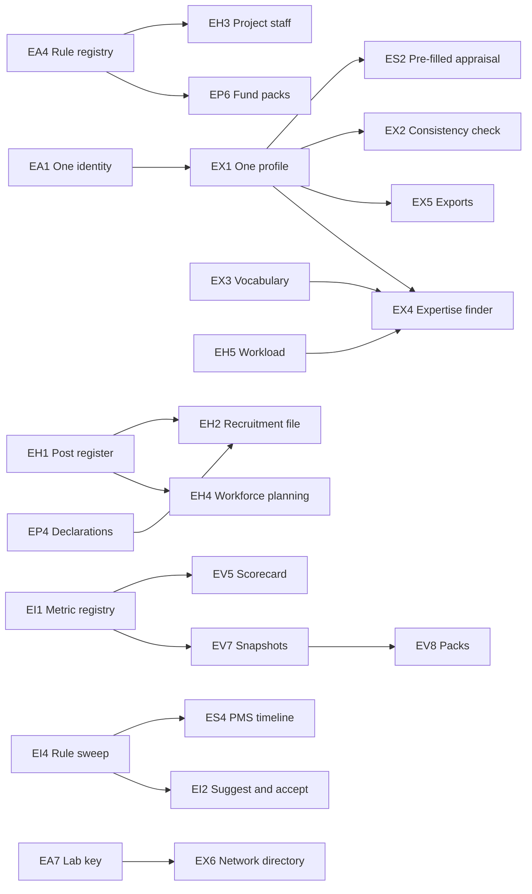

# Enterprise and AI-native plan

_Proposal, 2026-11-11. Item IDs `EA` `EI` `EP` `EH` `ES` `EX` `EV` `EG`. Indexed from
[`../ROADMAP.md`](../ROADMAP.md). Adds no work package: every item names the roadmap item
it builds on._

**Question asked.** What should change in design and architecture so that SURYA is an
enterprise project-monitoring system that stays AI-native for 5–10 years, in line with CSIR
guidelines? Fields of interest: project management, recruitment and sanctioned staff,
assessment, one consistent research profile per scientist, and expertise discovery for
HoDs, the Director and the DG.

**Read for this plan.**

- _CSIR Guidelines on Implementation, Monitoring and Financial Governance of Projects_, OM
  No. 33/GIM&FGP/2025-CPD, 25 April 2025 — through a reference summary (cited as "§n").
- `PMS-2026-GAP-REVIEW.md`, `PROJECT-LIFECYCLE-PLAN.md`, `REVIEW-2026-10-20.md`,
  `ROADMAP.md`, `VISION-ARCHITECTURE.md`, `docs/engineering/FEATURES.md`, and the HR and
  recruitment migrations.

**Limits — read these first.**

1. The guideline source was a **summary**, not the OM. Some table cells (the §3.3
   emoluments table) did not survive extraction. Load EA4 from the original OM.
2. The summary covers projects and **project** staff. It does **not** cover recruitment of
   permanent staff or assessment promotion. Items that need those rules are marked "rule
   text needed" and scored low on readiness. See §7.
3. Scores are a judgement by one reviewer. Change a rating and the rank changes; the method
   in §3 is what to keep.

---

## 1. Where the app stands

| Field | Built | Main gap |
|---|---|---|
| Project management | Full lifecycle `PL0`–`PL7`: private draft, review chain, sanction, funds ledger, milestones, monitoring, six change types, closure, lessons, portfolio, PME desk | Multi-lab projects, packs for HQ, conflict declarations, logbooks, externally funded track, finance import |
| Recruitment, sanctioned staff | Advertisements, posts per advertisement, applications, drive funnel; two strength integers per division | No post register; no case file; project-staff rules (§3.3) not encoded |
| Assessment | PMS state machine, tiered committees, grievance, Annual Work Plan, senior tracks | Proforma is the older layout; nothing is pre-filled from records |
| Research profile | Staff page with free-text expertise, CV uploads, IRINS mirror | Facts sit in six tables and are not one profile; nothing checks they agree |
| Expertise discovery | Ask SURYA expertise search, succession-risk function, co-authorship analysis | Free-text expertise; no ranked evidence; no load or availability |
| AI layer | Grounded answers with citations, whitelisted analytics, runs as the user, notifications and scheduled queries | No governed metric layer; AI reads but cannot propose; no GPU host |
| Architecture | RLS everywhere, RPC state machines, append-only audit, in-process DB tests | Whole institute loaded in the browser; HR columns are text; one lab assumed |

---

## 2. Ten-year design rules

These add to the standing constraints in `ROADMAP.md` §2. They do not replace any.

1. **Records outlive models.** Facts live in typed Postgres tables with stable IDs. The AI
   layer is replaceable; the records are not.
2. **Rules are dated data.** A CSIR rule is a row with a value, an effective date and the OM
   it came from. New OM, new row. (EA4)
3. **One definition per number.** Screen, export and AI call the same function. (EI1)
4. **One person, one profile.** PMS, the profile page, the expertise finder and exports all
   read the same records. Consistency comes from having one source, not from checking four.
   (EA1, EX1, ES2)
5. **AI proposes, a person accepts, the system logs.** (EI2)
6. **Standard interfaces only.** SQL, REST, a standard agent protocol. No logic locked
   inside one vendor's product. (EA6, EI5)
7. **Measure before you swap.** No model or prompt change without an eval run. (EI6)
8. **Every row knows its lab.** (EA7)
9. **The work is the record.** If a feature needs someone to file something again, redesign
   it.

---

## 3. How the scores work

Each item is rated 1–5 on six points. A higher rating is always better.

| Code | Point | Meaning of 5 | Weight |
|---|---|---|---|
| V | Value | Changes daily decisions for scientists, HoDs, the Director or the DG | 3 |
| U | Usability | Removes steps, retyping or searching for many users | 2 |
| C | CSIR compliance | A rule in hand demands it | 2 |
| L | Longevity | Still pays off in 10 years; makes later AI work easier | 2 |
| F | Feasibility | Fits the present stack and data; little new machinery | 2 |
| R | Readiness | Nothing outside the team blocks it (data, purchase, HQ, rule text) | 1 |

**Score** = (3V + 2U + 2C + 2L + 2F + R) ÷ 60 × 100.

**Tier.** `Now` ≥ 80 · `Next` 70–79 · `Later` < 70. A tier is a starting point. Dependencies
in §6 decide the real order.

**Read low scores with care.** Platform items (EA5, EA6, EA9, EI6) rate low on compliance
and usability because no rule asks for them and no user sees them. They are still needed.
§6 places them where they must come.

**Effort** as in the roadmap: `S` half a day · `M` 1–2 days · `L` 3+ days · `XL` multi-week.

---

## 4. The items, by dimension

### A. Architecture that lasts

The app is sound today. These items stop it from ageing. The idea is simple: **records and
rules must outlive every AI model and every screen.**

| ID | Feature | What it does | CSIR basis | Builds on | V | U | C | L | F | R | Score | Effort |
|---|---|---|---|---|---|---|---|---|---|---|---|---|
| `EA1` | **One identity per person** | One person record behind staff, project staff, students, logins and author names. Add ORCID and Vidwan IDs. Delete the name-matching fallback. | §3.3 (tenure counted across projects and labs needs one identity) | A3b, `staff.user_id` | 5 | 3 | 3 | 5 | 3 | 4 | **78** | L |
| `EA2` | **Typed HR core** | Typed twin columns for HR dates and numbers (`DOJ`, `DOB`, levels), as `PL0` did for projects. Fixed lists for designation, group, level, category. | — | `PL0` typed-twin pattern, HR casing debt | 4 | 3 | 2 | 5 | 3 | 5 | **72** | L |
| `EA3` | **One timeline per record and per person** | A single read view over `project_events`, PMS audit, contribution events and HR audit. Every dossier shows its own history. Gives "as it was on a date" later. | §8 (complete annexures at closure), PMS 2026 (permanent record) | F3, `project_events`, append-only audit | 4 | 4 | 3 | 5 | 4 | 5 | **82** | M |
| `EA4` | **CSIR rule registry** | Rules stored as dated data, not code: emoluments, age limits, tenure caps, ₹5 lakh limit, 20% overrun limit, deadlines. Each row names its OM and its effective date. A new OM is a new row, not a release. | Whole manual; §3.3 table is "w.e.f. 01.09.2024" and will change | `PL` §5.5 rules, PMS deadlines | 5 | 3 | 5 | 5 | 4 | 4 | **88** | M |
| `EA5` | **Load per role, compute in SQL** | Stop loading ~31 tables at login. Load per page. Move sums and counts into SQL views that the screen, the export and the AI all read. | — | WP-9, R4, A2 | 3 | 4 | 1 | 4 | 3 | 5 | **63** | L |
| `EA6` | **Replaceable AI engine** | One gateway (`rag/llm.py`) for every model call. Pinned model, recorded eval run per model, GPU host. A model swap is a config change. | — | WP-8, G7 | 4 | 4 | 1 | 5 | 3 | 2 | **67** | L |
| `EA7` | **Lab key on every table** | `lab_code` with an `'AMPRI'` default on all tables and in RLS. No second lab yet. It makes the DG view possible later without a rewrite. | §4.1 (nodal and participating labs) | WP-17 design doc | 3 | 1 | 2 | 5 | 3 | 5 | **60** | L |
| `EA8` | **Interchange with eHRMS, PFMS, IRINS** | Versioned import and export contracts. No retyping of data that another system owns. | §7.1 (expenditure statements) | WP-19, A5 | 4 | 2 | 3 | 5 | 2 | 1 | **62** | XL |
| `EA9` | **Run it like a service** | Backup with a rehearsed restore, alerts on worker death, release gates that block. | — | WP-8 | 4 | 2 | 2 | 5 | 3 | 4 | **67** | L |

### B. AI-native layer

"AI native" here means: the AI reads governed records, proposes actions, and a person
accepts them. It does **not** mean a chat box on top. The existing rules stay: answers cite
or refuse, no free-form SQL, no autonomous decisions.

| ID | Feature | What it does | CSIR basis | Builds on | V | U | C | L | F | R | Score | Effort |
|---|---|---|---|---|---|---|---|---|---|---|---|---|
| `EI1` | **Metric registry** | One governed definition per number (headcount, utilisation %, overdue reports). Dashboards, exports and Ask SURYA call the same function, so they cannot disagree. | — | WP-15 R1, catalog functions | 5 | 4 | 2 | 5 | 3 | 5 | **80** | L |
| `EI2` | **Suggest, accept, log** | An `agent_suggestions` record: the agent proposes (a reminder, a profile fix, a draft report line), a person accepts, the normal RPC runs as that person, and both steps are logged. | Constraint 9 (monitoring, not deciding) | G4, G5, notifications, contribution requests | 4 | 4 | 3 | 5 | 3 | 3 | **75** | L |
| `EI3` | **Ask from any record** | "Ask about this project / person / division" passes the record as context. Ask resolves names to records instead of matching text. | — | WP-15 R5, WP-4 I | 4 | 5 | 1 | 4 | 4 | 4 | **73** | M |
| `EI4` | **Finish the server-side rule sweep** | `notifications` and `scheduled_queries` exist. Move every remaining browser-only due-date rule to the server so deadlines are found when nobody is logged in. | §5 (minutes deadlines), §7.1, PMS Annexure-B | G1–G3, WP-2 | 4 | 4 | 3 | 4 | 4 | 5 | **78** | M |
| `EI5` | **Standard tool interface** | Expose the whitelisted catalog and record reads through a standard agent protocol (MCP), under the caller's own token. Any future assistant can use SURYA without a custom integration. | — | catalog functions, `rag/api.py` | 3 | 2 | 1 | 5 | 3 | 3 | **57** | M |
| `EI6` | **Eval gate on every model change** | The gold set and `run_eval.py` become a blocking step. No model or prompt change ships without a number. | — | WP-3 P10 | 3 | 1 | 1 | 5 | 4 | 4 | **58** | S |
| `EI7` | **Read documents at intake** | When a sanction OM, release order or minutes PDF is uploaded, the system reads it and pre-fills the form (OM no., date, IFD file no., amounts). A person checks and saves. The AWP import already works this way. | §7.2 (every OM must carry IFD file no. and date) | AWP import, `ingest/` | 4 | 5 | 2 | 4 | 3 | 3 | **72** | L |
| `EI8` | **Verified answers** | A good answer can be marked verified and reused, with its sources and a review date. | — | WP-15 R4 | 3 | 3 | 1 | 4 | 3 | 4 | **58** | M |

### C. Project management

The lifecycle (`PL0`–`PL7`) is built: draft, review chain, sanction, funds, milestones,
monitoring, changes, closure, lessons. These items cover what the April 2025 guidelines ask
for and the lifecycle does not yet do.

| ID | Feature | What it does | CSIR basis | Builds on | V | U | C | L | F | R | Score | Effort |
|---|---|---|---|---|---|---|---|---|---|---|---|---|
| `EP1` | **Multi-lab and network projects** | Nodal and participating labs per project, lab-wise budget and expenditure lines, the credit / IP sharing agreement on file before start, RC approvals of each lab annexed. | §4.1, §6.2, §7.1 | `PL3` ledger, work packages under one number | 4 | 3 | 5 | 4 | 3 | 4 | **77** | L |
| `EP2` | **Stage-gate deliverables pack** | Per-stage checklist (I–VI) for FTT / FTC / MMP. Before transfer: bill of materials, standard of preparation, supply chain and logistics documents. | §4.2 | `PL4` gate decisions | 3 | 3 | 5 | 3 | 4 | 5 | **73** | M |
| `EP3` | **Equipment usage logbook** | A usage log for every project instrument above ₹5 lakh, kept by the scientist-in-charge. Start with these only. | §3.1 (mandatory logbook) | C7, `equipment.project_id` | 3 | 3 | 5 | 3 | 4 | 4 | **72** | M |
| `EP4` | **Conflict-of-interest declarations** | Each committee member records Format 1 or Format 2 before a meeting. The system builds Annexure 3 (recused / Format 2 list). Applies to selection, review, purchase and transfer committees. | §6.3 | Committees module, `PL2` review steps | 3 | 3 | 5 | 4 | 4 | 5 | **77** | M |
| `EP5` | **Committee cadence and CPD half-yearly report** | LSG, Task Force, RC and Monitoring Committee calendars by rule. The half-yearly performance report to CPD (15 April, 15 September) compiled from the files. | §5 | `PL4` review slots | 4 | 4 | 5 | 3 | 4 | 5 | **82** | M |
| `EP6` | **Fund release and rephasing packs** | One click builds the package: head-wise expenditure statement, demand justification, earlier OMs, the four-signatory block. Checklist B runs before it prints. | §4.1.5, §7.1, §7.2, Checklist B | `PL3` ledger, `PL5` change requests | 4 | 5 | 5 | 3 | 4 | 5 | **85** | M |
| `EP7` | **Finance data import** | Monthly expenditure from PFMS or the accounts system replaces manual entry. | §7.1 | A5; ledger is shaped for it | 5 | 4 | 3 | 5 | 3 | 1 | **77** | M |
| `EP8` | **Laboratory Reserve Fund register** | LRF generated, 5% share to HQ, the one-third use floor, the 2 / 3 / 4% ceiling for the seven extra activities, temporary LRF use recouped in the same year. | §7.3, §3.1 | new; needs Finance | 3 | 2 | 4 | 3 | 3 | 2 | **58** | L |
| `EP9` | **Theme, category and TRL lens** | Portfolio by CSIR theme cluster (AMPRI sits mainly in 4M, code 08), by category, and by TRL reached against TRL targeted. | §1.3, §2.1, §2.2 | `/portfolio`, C1, A2 | 4 | 4 | 3 | 4 | 4 | 4 | **77** | M |
| `EP10` | **Externally funded and seed projects** | A third track for sponsored, consultancy and grant-in-aid projects, and a light one for OLP / seed projects under the Research Council. | §1.1 (excluded from this manual; own rules apply) | `project_schemes` (one more row) | 5 | 4 | 3 | 4 | 3 | 3 | **77** | L |
| `EP11` | **Outsourcing and retired-expert registers** | Outsourcing charged to the recurring head only. Retired-employee engagements with six-month terms and the right approver per level. | §6.1, §3.4 | `PL3` expenditure heads | 2 | 2 | 4 | 3 | 4 | 4 | **60** | M |
| `EP12` | **Publication file** | Each paper gets an institute communication number, a similarity-check record and the authors' signed contribution statement before it is submitted. The result is a verified output record. | §6.3 | WP-18 publication workflow, C4 | 4 | 3 | 5 | 4 | 3 | 4 | **77** | L |
| `EP13` | **Research data register** | Raw data and instrument printouts registered and archived per project, with the 18-month moratorium. | §6.3 | WP-18 dataset registry | 3 | 2 | 4 | 5 | 2 | 3 | **63** | XL |

### D. Recruitment and sanctioned staff

Today: two integers per division (sanctioned, current), an advertisement list, and a drive
funnel. There is no register of posts.

| ID | Feature | What it does | CSIR basis | Builds on | V | U | C | L | F | R | Score | Effort |
|---|---|---|---|---|---|---|---|---|---|---|---|---|
| `EH1` | **Sanctioned post register** | One row per sanctioned post: group, level, discipline, division, category, state (filled / vacant / advertised / kept in abeyance), and who holds it. Vacancy age and "falls vacant on" come from it. | Rule text needed (see §7) | `divisions` strength fields, `staff` | 5 | 4 | 4 | 5 | 4 | 3 | **87** | L |
| `EH2` | **Permanent recruitment case file** | One file per drive, tied to posts in EH1: advertisement, applications, screening, interview, selection, offer, joining. Committee, declarations (EP4) and every order on the file. Stages move by RPC. | Rule text needed (see §7) | `vacancy_*`, `vacancy_applications`, Committees | 5 | 4 | 4 | 4 | 3 | 2 | **78** | XL |
| `EH3` | **Project staff engagement** | Position catalogue with qualification, age and emoluments from EA4. Eligibility check. Selection committee make-up and quorum. NCS portal posting. Waitlist valid 12 months. Direct engagement under 12 months with recorded reason. No move between projects without fresh selection. The 6 / 7-year cap with the PhD exclusion. Leave ledger (12 days; maternity 180; paternity 15). | §3.3 | tenure alert, `project_staff`, EA1, EA4 | 5 | 4 | 5 | 4 | 3 | 4 | **85** | XL |
| `EH4` | **Workforce planning** | Retirements, vacancies and single-holder expertise on one view, by discipline and year. | §3.3 (optimal use of permanent staff) | B2, succession-risk function, EH1 | 4 | 4 | 2 | 4 | 4 | 4 | **73** | M |
| `EH5` | **Deployment and workload** | Per scientist: projects, role, value managed, and time % from the Annual Work Plan against the project teams. Shows overload and idle capacity. | §3.3, PMS 2026 Part V | B3, `pms_awps` | 4 | 4 | 4 | 4 | 4 | 4 | **80** | M |
| `EH6` | **Career timeline** | Appointments, promotions, transfers, deputation and training as dated events, imported from the establishment record. Not a service book and not payroll. | PMS 2026 Part I (basic information) | EA3; needs an eHRMS export | 4 | 4 | 3 | 5 | 3 | 2 | **73** | L |

### E. Assessment under CSIR rules

The PMS state machine, committees, grievance path and Annual Work Plan are built. The
proforma content still follows an older layout (`PMS-2026-GAP-REVIEW.md`).

| ID | Feature | What it does | CSIR basis | Builds on | V | U | C | L | F | R | Score | Effort |
|---|---|---|---|---|---|---|---|---|---|---|---|---|
| `ES1` | **PMS 2026 proforma and panel** | Questionnaire A and B, Appendix-A sections I–V with word limits, pen picture, integrity, one panel score, concur / upgrade / downgrade at the Empowered Committee, grade-tier routing, quorum. | PMS 2026 Annexure-A | PMS-2026-GAP-REVIEW P1 | 5 | 4 | 5 | 4 | 3 | 5 | **87** | XL |
| `ES2` | **Self-appraisal filled from records** | The report opens pre-filled from the scientist's projects, outputs, patents, students and work plan. The scientist confirms, corrects or adds. Each claim links to its record, so the committee can open the proof. | PMS 2026 Part II; vision rule "capture as a by-product" | EX1, C4 links, `pms_awps` | 5 | 5 | 4 | 5 | 3 | 4 | **88** | L |
| `ES3` | **Part I pre-fill and verification** | Establishment pre-fills basic information by 1 April. The scientist reports a discrepancy. Establishment verifies. | PMS 2026 Part I | EH6, contribution requests | 4 | 4 | 5 | 4 | 4 | 4 | **83** | M |
| `ES4` | **Full Annexure-B timeline** | All nine steps tracked with overdue flags, "deemed accepted" after 15 days, representation disposal in one month, and the delay report to DG. | PMS 2026 Annexure-B | EI4, notifications | 4 | 4 | 5 | 3 | 4 | 5 | **82** | M |
| `ES5` | **Assessment-promotion file** | For a scientist due for assessment: residency, PMS record over the period, and a work report compiled from the profile. | Rule text needed (see §7) | ES2, EX1, EH6 | 4 | 4 | 4 | 4 | 3 | 1 | **72** | L |
| `ES6` | **Multi-year view for entitled officers** | Score history and committee remarks across cycles, with the lab-average normalisation the guideline recommends. Visible only to those the rules entitle. | PMS 2026 (normalisation recommended) | `pms_reports`, RLS | 4 | 4 | 3 | 4 | 4 | 4 | **77** | M |
| `ES7` | **Digital signature** | DSC or e-sign in place of signed scans. | — | D6; decision 5 keeps scans | 2 | 3 | 2 | 3 | 1 | 1 | **42** | L |

### F. Research profile and expertise discovery

This is where the gain is largest for the least new data. The records exist; they are not
joined into one person.

| ID | Feature | What it does | CSIR basis | Builds on | V | U | C | L | F | R | Score | Effort |
|---|---|---|---|---|---|---|---|---|---|---|---|---|
| `EX1` | **One research profile, built from records** | Per scientist: service line, projects with role and value, outputs, patents, transfers, students, committees, work plan, lessons written. Every line is a record with a link. No typed claims. Views: self, HoD, Director, public. | PMS 2026 Part II (same facts) | `StaffDetail`, EA1, C4 links | 5 | 5 | 3 | 5 | 4 | 4 | **88** | L |
| `EX2` | **Profile consistency check** | Compares IRINS, SURYA outputs, PMS claims and project teams. A mismatch becomes a contribution request to the owner. Reuses the existing request flow. | §6.3 (authorship integrity) | IRINS sync, contribution requests | 5 | 4 | 3 | 5 | 4 | 4 | **85** | M |
| `EX3` | **Governed expertise vocabulary** | A managed list of materials, techniques and application areas, mapped to the nine theme clusters. The system suggests tags from a person's papers and projects; the person confirms. | §1.3 | WP-16 controlled vocabularies, B1 | 5 | 4 | 2 | 5 | 3 | 4 | **78** | L |
| `EX4` | **Expertise finder with proof** | "Who can do X?" returns ranked people with the evidence (projects, papers, patents, instruments), current load and years to retirement. Exports a one-page shortlist with sources. | §3.3 (deploy permanent staff first), §4.2 (team identification) | expertise-search function, EX1, EX3, EH5 | 5 | 5 | 2 | 5 | 3 | 4 | **82** | L |
| `EX5` | **Profile exports** | One-page CV, committee-nomination brief and bio-data formats, always generated from the records. | — | EX1, `@react-pdf/renderer` | 4 | 5 | 2 | 3 | 5 | 5 | **78** | S |
| `EX6` | **Network expertise directory (DG view)** | Cross-lab search by federation. Each lab keeps its own data. | §1.3, §4.1 (HQ checks duplication) | WP-19, EA7, EX3 | 4 | 3 | 2 | 5 | 1 | 1 | **58** | XL |
| `EX7` | **Self-service with verification** | A scientist edits a short list of own fields. Establishment verifies the ones that matter. Each change is audited. | PMS 2026 Part I | B4 | 4 | 5 | 2 | 4 | 4 | 5 | **78** | M |

### G. Analysis experience

One rule: a number on any screen must match the same number everywhere else, and one click
must show where it came from.

| ID | Feature | What it does | CSIR basis | Builds on | V | U | C | L | F | R | Score | Effort |
|---|---|---|---|---|---|---|---|---|---|---|---|---|
| `EV1` | **Role-first home and short menu** | My tasks, my numbers, Ask. At most six menu items per role; the rest under "More". | — | WP-5, R1–R3 | 4 | 5 | 1 | 4 | 4 | 5 | **75** | M |
| `EV2` | **Same dossier layout everywhere** | Person, project, division, instrument: header, key numbers, tabs, linked records, documents, timeline, Ask. | — | WP-4 G, EA3 | 4 | 5 | 1 | 4 | 3 | 5 | **72** | L |
| `EV3` | **Explain this** | On any chart: a plain-words reading with the rows behind it. | — | WP-15 R2, EI1 | 3 | 4 | 1 | 4 | 3 | 2 | **58** | L |
| `EV4` | **Digest and scheduled briefs** | A weekly brief per role, built by fixed rules. Saved questions that run on a schedule. | §5 (reviews fall due on dates) | WP-15 R3, `scheduled_queries` | 4 | 4 | 2 | 4 | 4 | 4 | **73** | M |
| `EV5` | **Division scorecard** | People, projects, money, outputs, students and equipment on one page with trends, on EI1 definitions. | — | `DivisionsAnalytics`, EI1 | 4 | 4 | 2 | 4 | 4 | 4 | **73** | M |
| `EV6` | **Phone: check and approve** | Inbox, numbers, record pages and approve buttons. Heavy forms say "open on desktop". | — | M1–M4 | 3 | 5 | 1 | 3 | 3 | 5 | **63** | L |
| `EV7` | **"As on date" snapshots** | Monthly stored snapshots of the governed metrics. Reports for 31 March or for a Research Council date stay reproducible. | §5 (half-yearly reports), §7.1 (year-wise statements) | EI1 | 4 | 3 | 3 | 5 | 4 | 5 | **78** | M |
| `EV8` | **Meeting and report packs** | Research Council pack, annual-report tables and review briefs compiled from records, each figure with its source. | §5, §8 | EV7, E1, `PL4` review brief | 4 | 5 | 3 | 4 | 4 | 4 | **80** | M |

### H. Governance and trust

| ID | Feature | What it does | CSIR basis | Builds on | V | U | C | L | F | R | Score | Effort |
|---|---|---|---|---|---|---|---|---|---|---|---|---|
| `EG1` | **Officiating and acting charge** | A dated assignment ("X acts as HoD from … to …"). Approvals route to the acting officer and the record says who acted in what capacity. | — | roles, RLS helpers | 4 | 4 | 3 | 4 | 3 | 4 | **73** | L |
| `EG2` | **Classification and retention at creation** | Access tier and retention class set when a record is born. Disposal by authorised action with a trail. | §6.3 (archival) | WP-18, `documents.access_tier` | 3 | 2 | 4 | 5 | 3 | 3 | **67** | L |
| `EG3` | **Two-factor login for admin roles** | TOTP for admin-tier roles. | — | F6 | 3 | 2 | 3 | 4 | 4 | 5 | **67** | M |
| `EG4` | **Accessibility and Hindi** | Full keyboard and screen-reader pass; Hindi interface. | Government website norms (confirm which apply) | WP-6, E6 | 3 | 4 | 4 | 4 | 2 | 3 | **67** | XL |
| `EG5` | **Personal-data review** | List the personal data held, its purpose, who reads it and how long it is kept. | Data-protection law (confirm with the institute) | RLS, access matrix | 3 | 1 | 4 | 5 | 3 | 3 | **63** | M |

---

## 5. All items, ranked

63 items: 16 `Now`, 28 `Next`, 19 `Later`.

| Rank | ID | Feature | Dimension | Score | Tier | Effort |
|---|---|---|---|---|---|---|
| 1 | `EA4` | CSIR rule registry | Architecture that lasts | 88 | Now | M |
| 2 | `ES2` | Self-appraisal filled from records | Assessment under CSIR rules | 88 | Now | L |
| 3 | `EX1` | One research profile, built from records | Research profile and expertise discovery | 88 | Now | L |
| 4 | `EH1` | Sanctioned post register | Recruitment and sanctioned staff | 87 | Now | L |
| 5 | `ES1` | PMS 2026 proforma and panel | Assessment under CSIR rules | 87 | Now | XL |
| 6 | `EH3` | Project staff engagement | Recruitment and sanctioned staff | 85 | Now | XL |
| 7 | `EP6` | Fund release and rephasing packs | Project management | 85 | Now | M |
| 8 | `EX2` | Profile consistency check | Research profile and expertise discovery | 85 | Now | M |
| 9 | `ES3` | Part I pre-fill and verification | Assessment under CSIR rules | 83 | Now | M |
| 10 | `EA3` | One timeline per record and per person | Architecture that lasts | 82 | Now | M |
| 11 | `EP5` | Committee cadence and CPD half-yearly report | Project management | 82 | Now | M |
| 12 | `ES4` | Full Annexure-B timeline | Assessment under CSIR rules | 82 | Now | M |
| 13 | `EX4` | Expertise finder with proof | Research profile and expertise discovery | 82 | Now | L |
| 14 | `EH5` | Deployment and workload | Recruitment and sanctioned staff | 80 | Now | M |
| 15 | `EI1` | Metric registry | AI-native layer | 80 | Now | L |
| 16 | `EV8` | Meeting and report packs | Analysis experience | 80 | Now | M |
| 17 | `EA1` | One identity per person | Architecture that lasts | 78 | Next | L |
| 18 | `EH2` | Permanent recruitment case file | Recruitment and sanctioned staff | 78 | Next | XL |
| 19 | `EI4` | Finish the server-side rule sweep | AI-native layer | 78 | Next | M |
| 20 | `EV7` | "As on date" snapshots | Analysis experience | 78 | Next | M |
| 21 | `EX3` | Governed expertise vocabulary | Research profile and expertise discovery | 78 | Next | L |
| 22 | `EX5` | Profile exports | Research profile and expertise discovery | 78 | Next | S |
| 23 | `EX7` | Self-service with verification | Research profile and expertise discovery | 78 | Next | M |
| 24 | `EP1` | Multi-lab and network projects | Project management | 77 | Next | L |
| 25 | `EP10` | Externally funded and seed projects | Project management | 77 | Next | L |
| 26 | `EP12` | Publication file | Project management | 77 | Next | L |
| 27 | `EP4` | Conflict-of-interest declarations | Project management | 77 | Next | M |
| 28 | `EP7` | Finance data import | Project management | 77 | Next | M |
| 29 | `EP9` | Theme, category and TRL lens | Project management | 77 | Next | M |
| 30 | `ES6` | Multi-year view for entitled officers | Assessment under CSIR rules | 77 | Next | M |
| 31 | `EI2` | Suggest, accept, log | AI-native layer | 75 | Next | L |
| 32 | `EV1` | Role-first home and short menu | Analysis experience | 75 | Next | M |
| 33 | `EG1` | Officiating and acting charge | Governance and trust | 73 | Next | L |
| 34 | `EH4` | Workforce planning | Recruitment and sanctioned staff | 73 | Next | M |
| 35 | `EH6` | Career timeline | Recruitment and sanctioned staff | 73 | Next | L |
| 36 | `EI3` | Ask from any record | AI-native layer | 73 | Next | M |
| 37 | `EP2` | Stage-gate deliverables pack | Project management | 73 | Next | M |
| 38 | `EV4` | Digest and scheduled briefs | Analysis experience | 73 | Next | M |
| 39 | `EV5` | Division scorecard | Analysis experience | 73 | Next | M |
| 40 | `EA2` | Typed HR core | Architecture that lasts | 72 | Next | L |
| 41 | `EI7` | Read documents at intake | AI-native layer | 72 | Next | L |
| 42 | `EP3` | Equipment usage logbook | Project management | 72 | Next | M |
| 43 | `ES5` | Assessment-promotion file | Assessment under CSIR rules | 72 | Next | L |
| 44 | `EV2` | Same dossier layout everywhere | Analysis experience | 72 | Next | L |
| 45 | `EA6` | Replaceable AI engine | Architecture that lasts | 67 | Later | L |
| 46 | `EA9` | Run it like a service | Architecture that lasts | 67 | Later | L |
| 47 | `EG2` | Classification and retention at creation | Governance and trust | 67 | Later | L |
| 48 | `EG3` | Two-factor login for admin roles | Governance and trust | 67 | Later | M |
| 49 | `EG4` | Accessibility and Hindi | Governance and trust | 67 | Later | XL |
| 50 | `EA5` | Load per role, compute in SQL | Architecture that lasts | 63 | Later | L |
| 51 | `EG5` | Personal-data review | Governance and trust | 63 | Later | M |
| 52 | `EP13` | Research data register | Project management | 63 | Later | XL |
| 53 | `EV6` | Phone: check and approve | Analysis experience | 63 | Later | L |
| 54 | `EA8` | Interchange with eHRMS, PFMS, IRINS | Architecture that lasts | 62 | Later | XL |
| 55 | `EA7` | Lab key on every table | Architecture that lasts | 60 | Later | L |
| 56 | `EP11` | Outsourcing and retired-expert registers | Project management | 60 | Later | M |
| 57 | `EI6` | Eval gate on every model change | AI-native layer | 58 | Later | S |
| 58 | `EI8` | Verified answers | AI-native layer | 58 | Later | M |
| 59 | `EP8` | Laboratory Reserve Fund register | Project management | 58 | Later | L |
| 60 | `EV3` | Explain this | Analysis experience | 58 | Later | L |
| 61 | `EX6` | Network expertise directory (DG view) | Research profile and expertise discovery | 58 | Later | XL |
| 62 | `EI5` | Standard tool interface | AI-native layer | 57 | Later | M |
| 63 | `ES7` | Digital signature | Assessment under CSIR rules | 42 | Later | L |

---

## 6. Suggested order

**Build plan for the `Now` and `Next` items:**
[`docs/superpowers/plans/2026-11-12-enterprise-phases.md`](../../superpowers/plans/2026-11-12-enterprise-phases.md)
— nine phases, with tables, function names and "done when". Where it differs from the waves
below, the phase plan wins.

Scores rank value. This order also respects what must exist first.

| Wave | Theme | Items | What the institute gets |
|---|---|---|---|
| 1 | **One person, one set of rules** | EA4, EA1, EX1, EX7, EX5, EX2, EI4 | Every scientist has one profile that the records prove. Rules stop living in code |
| 2 | **Compliance packs** (small, each ships alone) | EP6, EP5, EP4, ES3, ES4, EP2, EP3 | Paperwork for HQ and committees comes out of the file |
| 3 | **Assessment on evidence** | ES2, ES1, ES6, EH5 | The appraisal form fills itself; the committee opens the proof |
| 4 | **Posts and people** | EH1, EH3, EH4, EH2 | A real post register; project staff engaged by the rules |
| 5 | **Find and analyse** | EX3, EX4, EI1, EV1, EA3, EV2, EV5, EV7, EV8, EI3, EV4 | "Who can do X?" with proof; numbers that agree everywhere |
| 6 | **AI depth** | EA6, EI6, EI2, EI7, EI5, EV3, EI8 | The AI proposes work, on a host that can keep up |
| 7 | **Wider reach** | EP1, EP10, EP12, EA2, EA5, EA9, EG1, EG3 | Multi-lab and sponsored projects; a system that can be left running |
| Held | Waiting on something outside | EP7, EA8, EH6, ES5, EX6, EP8, EP13, EG2, EG4, EG5, ES7, EA7, EP9, EP11, EV6 | See the readiness rating of each |

**One recommendation.** Do wave 1 first. EX1 and EA4 are the two items that most other items
read from, and neither needs anything from outside the team.

---

## 7. Rule texts still needed

Do not build these from memory. Get the text, then load EA4.

| Needed for | Text to obtain | Default until then |
|---|---|---|
| EH1, EH2 | CSIR recruitment rules for scientists and for technical and administrative staff; reservation roster orders | Build the register and the file; leave rule checks off |
| ES5 | CSIR assessment-promotion rules for scientists | Compile the file; do not compute eligibility |
| EP10 | _CSIR Guidelines for Technology Transfer and Utilization of Knowledgebase (2017)_ and later OMs | Record the project; no rule checks |
| EA4 | The April 2025 OM itself, with enclosures (proformas, Checklist A and B, LRF enclosures 9–9c) | Values from the summary, each marked "unverified" |
| EG4, EG5 | Which accessibility and data-protection norms the institute must meet | Keep the present baseline |

**Open questions.**

| # | Question | Default if unanswered |
|---|---|---|
| 1 | Who owns the post register — Establishment (HRAdmin) or a new role? | HRAdmin |
| 2 | May a HoD see PMS scores of the division over years (ES6)? | Only what PMS 2026 already entitles |
| 3 | Is there a public profile view (EX1)? | No; self, HoD and Director only |
| 4 | Does assessment of non-scientist staff belong here? | No; scientists only |
| 5 | Will Finance provide a monthly export (EP7)? | Manual entry by PME continues |

---

## 8. What this plan does not change

- The standing constraints in `ROADMAP.md` §2 and the non-goals in §9.
- SURYA is still not payroll, not the service book, not the accounts system.
- HQ decisions are recorded here, never taken here.
- Signed scans stay the proof of a step (`PROJECT-LIFECYCLE-PLAN.md` decision 5).
- No autonomous action by an AI agent. EI2 is the only path, and it ends at a person.
