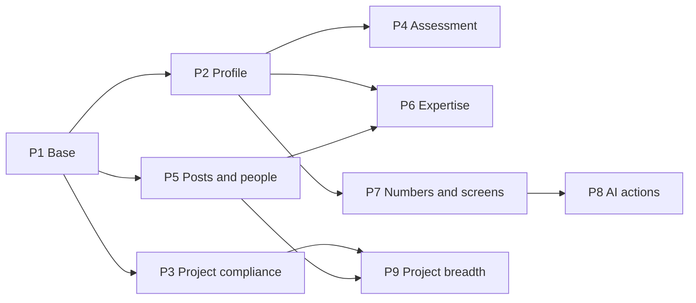

# Enterprise and AI-native — Phase Plan (Now + Next tiers)

> **For agentic workers:** this is the **master phase plan**. It fixes the order, the data
> model, the function names and the "done when" of each phase. It is not yet the step list.
> At the start of each phase, write that phase's task plan with the `writing-plans` skill
> (checkbox steps, failing test first), save it beside this file as
> `2026-11-12-enterprise-p<N>-<name>.md`, then build with `executing-plans`. One phase at a
> time. Reason: the 44 items span nine subsystems; a single step list would be guessed, not
> planned.

**Goal:** Build the 44 `Now` and `Next` items of the enterprise plan in nine phases, each of
which ships alone and leaves the app working.

**Architecture:** One source per fact. Phase 1 adds the shared base (dated rules, person
links, typed dates, one timeline). Every later phase reads from that base through SQL
functions that the screen, the PDF export and Ask SURYA all call. State changes go through
`SECURITY DEFINER` RPCs; reads go through invoker functions so existing RLS decides.

**Tech Stack:** React 19 + TypeScript (strict) + Tailwind 4 · Supabase Postgres (RLS, RPC,
`pg_cron`) · `@react-pdf/renderer` · Python `rag/` service · vitest + PGlite harness.

**Spec:** [`docs/roadmap/sources/ENTERPRISE-AI-NATIVE-PLAN.md`](../../roadmap/sources/ENTERPRISE-AI-NATIVE-PLAN.md)
(item IDs `EA` `EI` `EP` `EH` `ES` `EX` `EV` `EG`). Rule source: CSIR OM No.
33/GIM&FGP/2025-CPD, 25 April 2025 ("§n"), and `PMS-2026-GAP-REVIEW.md`.

## Global Constraints

- New tables: snake_case, RLS enabled, explicit policy block in the same migration.
- Every `SECURITY DEFINER` function opens with an authorization block and sets
  `search_path`. Actor ids from the client must equal `auth.uid()`. No blanket `GRANT ALL`.
- New migration = new file `supabase/migrations/<YYYYMMDDHHMMSS>_<name>.sql` after the last
  one (`20261112000003`). Never edit a shipped file. Apply with `supabase db push` only.
- Status columns change only inside RPCs. Never from the client.
- `PME` is not an admin. Never add it to `proposals_caller_is_admin()`.
- Project-side keys use `projects("ProjectID")`. `"ProjectNo"` is not unique.
- Pages read through `useData()` or a context; never Supabase directly. Derived data in
  `useMemo`. Semantic Tailwind tokens only. Read `DESIGN.md` before any screen.
- No autonomous action by an agent. A suggestion ends at a person's accept.
- Ask SURYA: whitelisted catalog functions only; cite or refuse.
- A CSIR value read from the summary and not from the OM is stored with `verified = false`.
- Each phase PR updates `docs/engineering/{database_design,api_spec,system_design,FEATURES}.md`
  and regenerates `access_matrix.md` when a route or role changes.

**Verification, every phase:** `npm run build` · `npm run lint` · `npm test` ·
`python scripts/check_security_definer.py` · `python -m pytest` in `rag/` when `rag/` changed.
Each phase adds one `scripts/db/<name>.db.test.ts` on the PGlite harness: happy path of each
RPC, one refusal per role that must be refused.

## Review Focus

Inputs the spec implies and that will bite a real user. Each has its test in the named phase.

1. **Two staff with the same or similar name.** Linking an author by name must never pick
   one silently; it leaves the link empty and lists it. (P1, `identity.db.test.ts`)
2. **A rule asked for on a date with no row.** `csir_rule()` raises; it never returns a
   default. (P1, `rules.db.test.ts`)
3. **Legacy rows with dates that do not parse.** Typed twin is `NULL`; tenure and age
   checks report "date missing", not zero days. (P1 and P5)
4. **A reader with no right to a person.** Profile and score-history functions return no
   rows, not an error and not another person's rows. (P2, P4)
5. **An acting assignment that ends while a file waits.** After the end date the acting
   officer is refused and the file returns to the principal. (P5, `acting.db.test.ts`)

---

## Order and why

Changes from the score order, each for a dependency:

| Item | Score rank | Moved | Reason |
|---|---|---|---|
| `EA1`, `EA2`, `EI4` | 17, 40, 19 | Up to P1 | Profile, tenure and deadlines all read them |
| `EV2` (dossier shell) | 44 | Up to P2 | The profile page is the first dossier; build the shell once |
| `ES1` | 5 | After `ES3`, `ES4`; before `ES2` | Pre-fill must target the 2026 form, or it is built twice |
| `EH3` | 6 | Down to P5 | Needs rules (P1) and person identity |
| `EX4` | 13 | Down to P6 | Needs profile, vocabulary and workload |
| `EI1` | 15 | Down to P7 | Nothing before P7 needs it; P7 is built on it |
| `EP7`, `ES5` | 28, 43 | Last, gated | Wait on a finance export and on rule text |

| Phase | Items | Effort | Ships |
|---|---|---|---|
| P1 Base | `EA4` `EA1` `EA2` `EI4` `EA3` | XL | Rules as data; people linked to their records |
| P2 Profile | `EX1` `EV2` `EX7` `EX5` `EX2` | XL | One research profile per scientist |
| P3 Project compliance | `EP4` `EP6` `EP5` `EP2` `EP3` | L | HQ and committee paperwork from the file |
| P4 Assessment | `ES4` `ES3` `ES1` `ES2` `ES6` | XL | PMS 2026 form that fills itself |
| P5 Posts and people | `EH1` `EH5` `EH4` `EH6` `EH3` `EH2` `EG1` | XL | Post register; project staff by the rules |
| P6 Expertise | `EX3` `EX4` | L | "Who can do X?" with proof |
| P7 Numbers and screens | `EI1` `EV7` `EV5` `EV8` `EV4` `EV1` `EP9` | XL | Numbers that agree; report packs |
| P8 AI actions | `EI3` `EI2` `EI7` | L | Ask from a record; suggestions; read OMs |
| P9 Project breadth | `EP1` `EP10` `EP12` · gated `EP7` `ES5` | XL | Multi-lab, sponsored projects, publication file |

---

## P1 — Base

**Items:** `EA4` rule registry · `EA1` one identity · `EA2` typed HR dates · `EI4` server
rule sweep · `EA3` one timeline.

> **Status 2026-11-12: built, not yet pushed.** Migrations `20261112000004`–`08`; tests
> `rules`, `identity`, `sweepParity` `.db.test.ts`; screens `/admin/rules`, `/data/links`.
> Deviations: starting rules live in the migration (code needs two of them on a fresh
> database); `project_staff.positions` not loaded (enter from the OM); the link column is
> `pos` (`position` breaks plpgsql); the browser name-match fallback
> (`getStaffPortfolio`) is removed in P2, when `StaffDetail` moves to `staff_profile_facts`.

**Found in the code:** `staff.user_id` exists; `admin_staff_link_gaps()` lists unlinked
staff. `scientific_outputs.authors` and `ip_intelligence.inventors` are `text[]` of names —
no link to a person. HR dates are `text`; `try_parse_date()` exists. `notifications` and
`notifications_sweep()` exist; browser rules live in `src/lib/dashboard/myActions.ts`.

| Migration | Adds |
|---|---|
| `_csir_rules.sql` | `csir_rules(id, rule_key, value jsonb, unit, effective_from date, effective_to date, source_ref text NOT NULL, verified boolean DEFAULT false, note, created_by, created_at)`; `UNIQUE (rule_key, effective_from)`. Read: verified users. No direct write |
| `_identity_links.sql` | `staff.orcid`; `output_authors(output_id, position, author_name, staff_id NULL, link_source 'auto'\|'manual', confirmed_by, confirmed_at)`; `ip_inventors` same shape; `phd_students.supervisor_staff_id` (confirm column names at phase start) |
| `_hr_typed_dates.sql` | `staff.doj_date / dob_date / doapp_date`, `project_staff.joined_on / project_ends_on`, `contract_staff.joined_on / ends_on / born_on` — `date`, filled by trigger from the text column with `try_parse_date` |
| `_entity_timeline.sql` | View `entity_timeline(entity_type, entity_id, at, actor_user_id, kind, summary, source)` `WITH (security_invoker = true)` over `project_events`, `pms_audit_logs`, `contribution_request_events`, HR audit |
| `_sweep_parity.sql` | New rule branches in `notifications_sweep()` |

**Functions**

- `csir_rule(p_key text, p_on date DEFAULT ist_today()) RETURNS jsonb` — `STABLE`, invoker.
  Raises `'no CSIR rule % on %'` when none.
- `csir_rule_set(p_key text, p_value jsonb, p_unit text, p_effective_from date, p_source_ref text, p_verified boolean) RETURNS uuid`
  — MasterAdmin only. Closes the earlier row (`effective_to = p_effective_from - 1`).
  Rows are never updated or deleted otherwise.
- `identity_link_authors() RETURNS integer` — links only when exactly one staff member
  matches; else leaves `staff_id NULL`.
- `identity_link_gaps() RETURNS TABLE(kind text, record_id text, name text, candidates integer)`
  — extends `admin_staff_link_gaps()`.
- `identity_set_link(p_kind text, p_record_id text, p_position integer, p_staff_id text)` —
  data admins and the staff member named.

**Seed (`supabase/seed/<NN>_csir_rules.sql`), all `effective_from 2025-04-25` unless stated,
`verified = false` until checked against the OM:**

| `rule_key` | Value | Source |
|---|---|---|
| `project.major_equipment_threshold_inr` | 500000 | §3.1 |
| `project.cost_overrun_dg_limit_pct` | 20 | §6.4 |
| `project_staff.tenure_cap_years` | 6 | §3.3 |
| `project_staff.tenure_cap_years_short_industry` | 7 | §3.3 |
| `project_staff.paid_leave_days_per_year` | 12 | §3.3 |
| `project_staff.maternity_leave_days` / `paternity_leave_days` | 180 / 15 | §3.3 |
| `project_staff.age_relaxation_years` | `{"SC":5,"ST":5,"PwBD":5,"Women":5,"OBC":3}` | §3.3 |
| `project_staff.waitlist_validity_months` / `waitlist_min_project_months` | 12 / 18 | §3.3 |
| `project_staff.direct_engagement_max_project_months` | 12 | §3.3 |
| `project_staff.selection_quorum` | `{"chair":1,"members":2}` | §3.3 |
| `project_staff.positions` (`effective_from 2024-09-01`) | catalogue: code, max age, emoluments | §3.3 — **summary table is damaged; enter from the OM** |
| `committee.minutes_due_days` | `{"LSG":2,"TFM":7}` | §5 |
| `monitoring.cpd_halfyearly_due` | `["04-15","09-15"]` | §5 |

**Code:** `src/lib/rules/csirRules.ts` (typed reader over a `RulesContext`), admin screen tab
in `src/pages/admin/` to add a dated row, link-gap screen beside Data Management. Switch
the existing ₹5 lakh and 20% checks (proposal readiness, `proposal_submit`, change-request
RPC) to `csir_rule()`; then delete the name-string fallback in the staff-linking path.

**`EI4` method:** list every rule in `myActions.ts`; for each, name the branch in
`notifications_sweep()` or add it. One table-driven test asserts both give the same items
for the same fixture.

**Done when**

- Changing a rule is one `csir_rule_set` call; the old value still answers for an old date.
- `identity_link_gaps()` returns only rows a person must decide; the fallback is deleted.
- A deadline raises a notification with nobody logged in (db test runs the sweep).
- `entity_timeline` for one project shows funds, review and change events in order.
- Existing project and proposal db tests pass unchanged after the switch to `csir_rule()`.

**Not in P1:** vocabulary lists for designation / group (a report function only, no `CHECK`,
or the importer breaks). `lab_code` (`EA7`, `Later`).

---

## P2 — Profile

**Items:** `EX1` one profile · `EV2` dossier shell · `EX7` self-service · `EX5` exports ·
`EX2` consistency check.

> **Status 2026-11-12: built, not yet pushed.** Migrations `20261112000010`–`12`; test
> `profile.db.test.ts`; `Dossier.tsx`, `StaffDetail.tsx` on `staff_profile_facts`, `/me`,
> `profilePdf.tsx`, `rag/analytics.py`. P1's leftover browser name match
> (`getStaffPortfolio`) now feeds only `lib/scientist/dossier.ts` — the trajectory flags,
> the markdown brief and the PMS `EvidencePanel`; it moves to the facts with `ES2` in P4.
> The consistency request reuses `contribution_requests` (domain `staff`) and is inserted
> by the sweep, since `contribution_request_create` needs a signed-in caller.

| Migration | Adds |
|---|---|
| `_staff_profile.sql` | `staff_profile_facts(p_staff_id text, p_from date DEFAULT NULL, p_to date DEFAULT NULL) RETURNS TABLE(section text, record_type text, record_id text, title text, role text, date_from date, date_to date, amount numeric, link text)` — **invoker**. Sections: `SERVICE`, `PROJECT`, `OUTPUT`, `IP`, `TECH_TRANSFER`, `STUDENT`, `COMMITTEE`, `AWP`, `LESSON`, `EQUIPMENT` |
| `_profile_self_service.sql` | `update_own_profile(p_fields jsonb)` — allowed keys only: `Expertise`, `CoreArea`, `Ext`, `orcid`, `VidwanID`. Writes an audit row. Anything else is refused |
| `_profile_consistency.sql` | `profile_consistency_issues(p_staff_id text DEFAULT NULL) RETURNS TABLE(staff_id text, kind text, record_ref text, detail text)`; `profile_consistency_sweep()` raising one live contribution request per staff member through `contribution_request_create` |

Issue kinds: `IRINS_OUTPUT_NOT_IN_SURYA` · `OUTPUT_AUTHOR_UNLINKED` · `PI_NAME_UNLINKED` ·
`AWP_PROJECT_NOT_ON_TEAM` · `STUDENT_SUPERVISOR_UNLINKED`.

**Code**

- `src/components/layout/Dossier.tsx` — header, key numbers, tabs (`useUrlTab`), linked
  records (`RelatedRail`), documents, timeline (`entity_timeline`). Named export.
- `src/pages/StaffDetail.tsx` rebuilt on `Dossier`; new route `/me` (own profile) in
  `App.tsx`, `ACCESS_MAP`, `Sidebar.tsx`.
- `src/contexts/ProfileContext.tsx` — loads facts per person on demand, not at login.
- `src/lib/staff/profilePdf.tsx` — `ProfileCv` (one page) and `NominationBrief`.
- `rag/analytics.py` `_staff_profile` and `_projects_for_staff` call `staff_profile_facts`.

**Done when**

- A scientist opens `/me` and every line opens the record behind it.
- A HoD sees profiles of the division; another division's HoD gets no rows (db test).
- The CV PDF holds no value that is not in `staff_profile_facts`.
- A paper in IRINS and not in SURYA shows as one request in the owner's My Work.

**Not in P2:** public profile view (open question 3). Applying `Dossier` to projects,
divisions and instruments — P7.

---

## P3 — Project compliance

**Items:** `EP4` declarations · `EP6` fund packs · `EP5` cadence and CPD report · `EP2`
stage-gate pack · `EP3` logbook. Independent of P2; may run before it.

> **Status 2026-11-12: built, not yet pushed.** Migrations `20261112000013`–`17`; test
> `compliance.db.test.ts`. Deviations: stage items are a seeded table with a foreign key, not
> a `CHECK` (one list for SQL and UI); item labels follow the summary — check them against
> the OM. The review-slot generator is unchanged: committee cadence still comes from the
> 20261111000003 schedule, not yet from `csir_rule('committee…')`. Annexure 3 is built in the
> browser from the rows the chair may read; no SQL function.

| Migration | Adds |
|---|---|
| `_coi_declarations.sql` | `coi_declarations(id, meeting_id, member_user_id, format 'F1'\|'F2', conflict_note, chair_decision 'CONTINUE'\|'RECUSE', decided_by, declared_at)`, `UNIQUE (meeting_id, member_user_id)`. RPCs `coi_declare(p_meeting_id uuid, p_format text, p_note text)`, `coi_chair_decide(p_id uuid, p_decision text)`. Readable by chair, convener and the member only (§6.3: confidential) |
| `_project_packs.sql` | `project_pack(p_project_id text, p_kind text, p_change_request_id uuid DEFAULT NULL) RETURNS jsonb` — kinds `FIRST_RELEASE`, `NEXT_YEAR_RELEASE`, `REPHASING`, `REAPPROPRIATION`; `project_checklist_b(p_change_request_id uuid) RETURNS TABLE(item text, ok boolean, detail text)` |
| `_cpd_halfyearly.sql` | `project_cpd_halfyearly(p_period_end date) RETURNS TABLE(...)` one row per project; review slots for LSG / Task Force / RC / MC generated from `csir_rule('committee…')` |
| `_stage_gate_pack.sql` | `project_stage_deliverables(project_id, stage smallint 1–6, item_key, document_id, done_by, done_at)`; fixed `item_key` list with a `CHECK` |
| `_equipment_usage_log.sql` | `equipment_usage_log(id, equipment_id, used_on, hours numeric, user_staff_id, project_id, purpose, logged_by, logged_at)`; insert-only |

**Decisions (mine — change if wrong)**

- A missing declaration **flags** the meeting on the PME desk. It does not block the
  decision, because the signed scan stays the proof (lifecycle decision 5).
- A technology transfer on an FTT / FTC / MMP project without BOM, standard of preparation,
  supply-chain and logistics documents is **flagged**, not refused.
- The logbook is required only where `equipment.project_id` is set and cost is above
  `csir_rule('project.major_equipment_threshold_inr')`.

**Code:** `src/lib/projects/packPdf.tsx`, `stageGate.ts`; Committees meeting page gains a
Declarations panel and the Annexure 3 PDF; project file gains a Packs action on Funds and
Changes; `InstrumentDetail.tsx` gains Usage; PME desk gains three counts.

**Done when**

- The next-year release pack matches a worked ledger example to the rupee and names the four
  signatories (PI, Head PME, F&AO / CoFA, Director).
- `project_checklist_b` returns `ok = false` for a rephasing that touches TA or manpower.
- Annexure 3 lists exactly the recused and Format 2 members.
- The CPD report for a period lists every HQ-track project with reviews held and missed.

---

## P4 — Assessment

**Items, in this order:** `ES4` timeline · `ES3` Part I · `ES1` 2026 form and panel · `ES2`
pre-fill from records · `ES6` multi-year view. Read `.claude/skills/pms-data-model/SKILL.md`
first.

> **Status 2026-11-13: built, not yet pushed.** Migrations `20261112000018`–`22`; test
> `pmsAssessment.db.test.ts`. Built: proforma version, tier routing, one panel score, EC
> concur / upgrade / downgrade, quorum, Part I, items from the profile, timeline + sweep +
> delay report, score history. Checked against the guideline text (2026-11-13,
> `20261112000024`): form wording and word limits in `src/lib/pms/proforma2026.ts`, 15
> pen-picture items in `pms_pen_picture_items`, integrity as Appendix-B text, 2026 rules for
> the standard track only. Designation → pay level and tier are `csir_rules` rows (unverified;
> the guideline confirms Pay Level 13 = Scientist-E and F). The live `staff."Level"` column is
> not the pay level.

| Step | Adds |
|---|---|
| `ES4` | `pms_timeline_status(p_cycle_id uuid) RETURNS TABLE(step smallint, due date, done integer, pending integer, overdue integer)` for the nine Annexure-B steps; sweep branches; `pms_reports.deemed_accepted_at` set by the sweep 15 days after communication; delay-report PDF for the DG |
| `ES3` | `pms_part1(report_id, data jsonb, prefilled_by, prefilled_at, discrepancy text, verified_by, verified_at)`; RPCs `pms_part1_prefill(p_cycle_id uuid)` (HRAdmin; from `staff` and, later, career events), `pms_part1_report_discrepancy(p_report_id uuid, p_text text)`, `pms_part1_verify(p_report_id uuid)` |
| `ES1` | `pms_reports.proforma_version` (`'LEGACY'` \| `'2026'`); 2026 sections I–V with word limits 150 / 100 / 300; Questionnaire A (all) and B (Pay Level 13+); pen picture (15 items, 4-point, no marks); integrity; `pms_panel_scores(report_id, committee_id, score 0–100, reasons, signed_scan)` — one row per panel; Empowered Committee `ec_action 'CONCUR'\|'UPGRADE'\|'DOWNGRADE'` with reasons; `pms_assign_evaluators` refuses a committee of the wrong grade tier; quorum recorded |
| `ES2` | `pms_report_items(id, report_id, section, source_record_type, source_record_id, text, state 'PREFILLED'\|'CONFIRMED'\|'EDITED'\|'ADDED'\|'REMOVED')`; `pms_prefill_from_profile(p_report_id uuid) RETURNS integer` — owner only, `DRAFT` only, reads `staff_profile_facts` for the reporting year, never overwrites an item the scientist touched |
| `ES6` | `pms_score_history(p_staff_id text) RETURNS TABLE(cycle, score, grade, lab_average, normalised)` — definer; allowed: self, Director, Empowered Committee, and the RO / RvO of the current cycle |

**Rules that must hold**

- Old reports keep `proforma_version = 'LEGACY'` and render in the old layout. No data move.
- Reasons required at score ≥ 90; reasons and suggestions at ≤ 75 (already enforced — keep).
- The cycle lock after 30 November stays absolute.
- A pre-filled line is a suggestion. Only the scientist's confirmation makes it a claim.

**Done when**

- A new report opens with the year's projects, papers, patents and students listed, each
  with a link the committee can open.
- A Scientist E sees Questionnaire B; a Scientist C does not.
- One panel score exists per report; three separate member scores cannot be filed.
- A representation not disposed in one month shows overdue with nobody logged in.
- `pms_score_history` returns nothing to a HoD who is not the RO (db test).

**Not in P4:** assessment promotion (`ES5`, gated). Digital signature (`ES7`).

---

## P5 — Posts and people

**Items, in this order:** `EH1` post register · `EH5` workload · `EH4` planning · `EH6`
career timeline · `EH3` project staff · `EH2` recruitment file · `EG1` acting charge.

> **Status 2026-11-13: built, not yet pushed.** Migrations `20261113000001`–`04`; test
> `people.db.test.ts`. Decisions: rules are read for the day of the decision, not the
> engagement dates (the registry starts 2025-04-25); the 7-year cap for short / industry
> projects is not applied — §3.3's condition for it is not in the summary; the position
> catalogue is still to be loaded, so the age limit reports "unknown" without blocking;
> `divisions` strength fields are filled from the register in `DataContext`; the career
> importer is an Excel/CSV upload on Sanctioned Posts, not a Data Management domain;
> `acted_as` is derived in `entity_timeline`, no approval RPC was changed. **Run the security
> review on `caller_has_role` / `caller_in_division` before relying on acting charges.**

| Migration | Adds |
|---|---|
| `_sanctioned_posts.sql` | `sanctioned_posts(id, post_code UNIQUE, staff_group, level, designation, discipline, division_code, category, state 'FILLED'\|'VACANT'\|'ADVERTISED'\|'ABEYANCE'\|'ABOLISHED', holder_staff_id, vacant_since, sanction_ref)`; `sanctioned_post_events` (append-only). RPCs `post_fill(p_post_id, p_staff_id, p_order_ref)`, `post_vacate(p_post_id, p_on, p_reason)`, `post_set_state(p_post_id, p_state, p_order_ref)` — HRAdmin. View `division_strength(division_code, sanctioned, filled, vacant)` |
| `_staff_workload.sql` | `staff_workload(p_staff_id text DEFAULT NULL) RETURNS TABLE(staff_id, active_projects, as_pi, sanctioned_value, awp_time_pct jsonb, overload boolean)` — invoker; overload at more than 4 active projects (roadmap `B3`) |
| `_career_events.sql` | `staff_career_events(id, staff_id, kind 'APPOINTMENT'\|'PROMOTION'\|'TRANSFER'\|'DEPUTATION'\|'TRAINING'\|'ASSESSMENT'\|'RETIREMENT', effective_on, detail jsonb, order_ref, source 'IMPORT'\|'MANUAL')`; new importer domain |
| `_project_staff_engagement.sql` | `project_staff_persons(id, name, born_on, category, gender, phd_registered_on, thesis_submitted_on, abroad_last_5y boolean)`; `project_selections(id, project_id, position_code, advert_ncs_ref, advert_on, committee jsonb, mode 'SELECTION'\|'DIRECT'\|'WAITLIST', exigency_note, waitlist_valid_until, minutes_document_id)`; `project_engagements(id, person_id, project_id, position_code, from_on, to_on, emoluments, selection_id)`; `project_staff_leave(id, engagement_id, kind, from_on, to_on)` |
| `_recruitment_cases.sql` | `vacancy_posts.sanctioned_post_id`; `recruitment_events` (append-only); `recruitment_advance(p_advt_id text, p_stage text, p_document_id uuid)`; trigger refuses a client write to `drive_stage` |
| `_acting_assignments.sql` | `acting_assignments(id, role, division_code, principal_user_id, acting_user_id, from_on, to_on, order_ref, created_by)`; `caller_has_role()` and `caller_division()` honour an assignment that is active today; approval RPCs record `acted_as` |

**Functions for `EH3`**

- `project_staff_tenure_days(p_person_id uuid, p_on date) RETURNS integer` — sum of all
  engagements minus the PhD window (registration to thesis submission).
- `project_engagement_check(p_person_id uuid, p_project_id text, p_position_code text, p_from date, p_to date) RETURNS TABLE(rule text, ok boolean, detail text)`
  — age (with relaxation), tenure cap 6 or 7, quorum, waitlist validity, direct engagement
  only under 12 months with a note, no move between projects without a fresh selection,
  antecedent check when abroad in the last 5 years.
- `project_engage(p_selection_id uuid, p_person_id uuid, p_from date, p_to date)` — PME or
  HRAdmin; refuses when any check with a hard rule fails.

**Notes**

- Legacy `project_staff` rows are back-filled into persons and engagements by name and
  project; ambiguous ones wait on a desk list. The old table stays for the importer.
- `EH2` builds the file and the stage RPC. **Rule checks stay off** until the recruitment
  rules are supplied (spec §7).
- `EH6` needs data from Establishment. It ships with the importer; it is empty until fed.
- `EG1` changes two security helpers. Run `/security-review` on that PR before merge.

**Done when**

- The Human Capital page shows sanctioned, filled and vacant from the register, and the two
  integers on `divisions` are no longer read.
- An engagement that would take a person past 6 years is refused; the same person with a
  PhD window that brings it under 6 is accepted.
- An advertisement cannot change stage from the browser console.
- An acting HoD approves within the dates and is refused the day after.

---

## P6 — Expertise

**Items:** `EX3` vocabulary · `EX4` finder. Needs P2 and `EH5` from P5.

| Migration | Adds |
|---|---|
| `_expertise_terms.sql` | `expertise_terms(id, label, kind 'MATERIAL'\|'TECHNIQUE'\|'APPLICATION', theme_code '01'–'09', parent_id, status 'ACTIVE'\|'MERGED', merged_into)`; `staff_expertise(staff_id, term_id, source 'SELF'\|'SUGGESTED', confirmed_at, evidence_count)`. Terms managed by a data steward |
| `_expertise_find.sql` | `expertise_suggest(p_staff_id text) RETURNS TABLE(term_id, evidence_count)` — label match against titles of the person's linked outputs, IP and projects; no model call. `expertise_find(p_term_ids uuid[], p_text text DEFAULT NULL) RETURNS TABLE(staff_id, name, division, evidence jsonb, evidence_count, active_projects, overload, retires_on)` — invoker, ranked by confirmed terms then evidence |

> **Status 2026-11-13: built, not yet pushed.** Migration `20261113000006_expertise.sql`
> (one file, not two); test `expertise.db.test.ts`. Decisions: `evidence_count` is computed
> by `expertise_find`, not stored; people with evidence but no confirmed tag are listed after
> everyone with one (so the finder works before anyone confirms); the `Expertise` note
> counts as one evidence item; the tag panel is an Expertise tab on the staff profile
> (`/me` opens it); the vocabulary editor on `/expertise` shows for HR and MasterAdmin only,
> though staff-domain stewards may also write through the API.

**Code:** `/expertise` page (search, ranked cards with evidence links, shortlist PDF through
`profilePdf.tsx`); tag confirm panel on `/me`; `rag/analytics.py` `_expertise_search` and
`_expertise_succession_risk` call the new functions. Free-text `Expertise` stays as a note.

**Done when**

- "Who can do X?" returns people with the count and links of papers, patents and projects,
  their load, and the year they retire.
- A suggested tag does not count in ranking until the person confirms it.
- The page and Ask SURYA give the same people for the same term.

---

## P7 — Numbers and screens

**Items, in this order:** `EI1` metric registry · `EV7` snapshots · `EP9` theme / TRL lens ·
`EV5` division scorecard · `EV8` packs · `EV4` digest · `EV1` role-first home.

| Migration | Adds |
|---|---|
| `_metrics.sql` | `metrics(key PRIMARY KEY, label, definition, unit, scope_kinds text[], fn regproc, owner_role)`; `metric_value(p_key text, p_scope jsonb DEFAULT '{}') RETURNS numeric` — invoker, dispatches only to registered functions. First set: headcount, sanctioned / filled / vacant posts, active projects, sanctioned value, utilisation %, overdue reports, overdue reviews, outputs per year, patents by stage, students in progress |
| `_metric_snapshots.sql` | `metric_snapshots(metric_key, scope jsonb, as_on date, value numeric, PRIMARY KEY (metric_key, scope, as_on))`; `metric_snapshot_run()` monthly by `pg_cron` as a definer function writing institute and division scopes only |
| `_project_lens.sql` | `projects.theme_code`, `trl_target`, `trl_reached` where not already present (confirm at phase start) |

**Code:** analytics pages replace inline sums with `metric_value` one page at a time
(continues roadmap `A2`); `rag/analytics.py` catalog entries call the same functions;
`src/pages/DivisionsAnalytics.tsx` scorecard with trend from snapshots;
`src/lib/reports/packs.tsx` (Research Council pack, annual-report tables) with an "as on"
date; weekly digest per role from `scheduled_queries`; `NAV_SECTIONS` items gain
`primaryFor: Role[]`, the rest fold under "More"; `Dossier` applied to project, division and
instrument pages.

**Done when**

- One number, three places (dashboard, export, Ask SURYA) — a test asserts equality.
- A pack for 31 March printed today and printed next month is identical.
- No role sees more than six primary menu items.

> **Status 2026-11-13: built, not yet pushed.** One migration `20261113000007_metrics.sql`
> (registry, snapshots, lens, digest); tests `metrics.db.test.ts`, `src/lib/metrics/metrics.test.ts`,
> RAG `test_metric_quotes_metric_value`. Decisions: the digest is a SQL notification
> (no model, so it runs without the RAG host), not a `scheduled_queries` entry; the pack is
> one landscape PDF of all metrics by division from the snapshot of the chosen day; the
> scorecard is the first page on `metric_value`, other analytics pages still sum in the
> browser; `PRIMARY_NAV` already held ≤ 6 items per role, so only the test was added;
> **`Dossier` on project, division and instrument pages is not done** — a separate UI
> change. Utilisation counts `project_expenditure` only and is NULL until any is recorded.
> Overdue counts include review slots generated back to each legacy project's start date.

**Not in P7:** "Explain this" (`EV3`, `Later`). Phone layout (`EV6`, `Later`).

---

## P8 — AI actions

**Items:** `EI3` ask from a record · `EI2` suggest, accept, log · `EI7` read documents at
intake.

**Found in the code:** `notifications` already carries `source 'agent'`, `proposed_action
jsonb` and status `accepted` / `dismissed`. So `EI2` is a whitelist and a log, not a new
table.

- `EI3` — `rag` `/query` accepts `context_entity {type, id}`; the router resolves names
  through the P1 links; `Dossier` gets "Ask about this" → `/ask?entity=<type>:<id>`.
- `EI2` — `src/lib/notifications/actions.ts`: map of action kind → one existing RPC and its
  argument shape. `notification_accept(p_id uuid)` marks accepted and logs; the client then
  calls the mapped RPC **as the user**. An action kind not in the map cannot run. First
  suggesters are fixed rules: link this author, confirm this tag, file this overdue report.
- `EI7` — `src/lib/documents/omExtract.ts` on the AWP-import pattern (text layer, else OCR,
  in the browser): OM number, OM date, IFD file number and date, amounts by head. Pre-fills
  the receipt and sanction forms. A person saves.

**Done when**

- From a project page, a question is answered about that project with citations.
- Accepting a suggestion writes the accept and the resulting change to the audit trail with
  the same user.
- An uploaded release order fills the receipt form; a file with no text fills nothing and
  says so.
- `python eval/run_eval.py --report` shows no regression against the run before P8.

> **Status 2026-11-13: built, not yet pushed.** Migration `20261113000008_ai_actions.sql`;
> tests `aiActions.db.test.ts`, `omExtract.test.ts`, RAG `test_question_from_a_project…`,
> `test_context_entity_…`. Decisions: the whitelist lives in the database
> (`notification_accept` runs the action in the same transaction as the accept and the
> log), not in a client map, so a forged row cannot run anything; "file this overdue
> report" is not added — `notifications_sweep` already sends it with the link; the OM
> reader fills the receipt form only (the sanction form is not wired yet). `run_eval.py`
> with the stand-in model: router 34/58, refusal 4/4 — P8 did not touch router, retrieval
> or the catalogue, so a regression check needs the GPU host.

**Not in P8:** model-written suggestions — they need the GPU host (`EA6`, `Later`).

---

## P9 — Project breadth

**Items:** `EP1` multi-lab · `EP10` externally funded and seed · `EP12` publication file.
**Gated:** `EP7` finance import · `ES5` assessment-promotion file.

- `EP1` — `project_labs(project_id, lab_code, role 'NODAL'\|'PARTICIPATING', rc_approval_document_id)`;
  `lab_code` on budget, receipt and expenditure lines (default the institute's code);
  `project_ip_agreements(project_id, document_id, signed_on)` flagged when a multi-lab
  project turns `ACTIVE` without one (§6.2). Packs from P3 gain lab-wise tables.
- `EP10` — two rows in `project_schemes` (`EFP`, `OLP`); review steps per track. No rule
  checks for `EFP` until the 2017 guidelines are supplied.
- `EP12` — `publication_files(id, output_id NULL, title, communication_no UNIQUE, similarity_pct, similarity_report_document_id, status 'DRAFT'\|'ETHICS_CHECK'\|'CLEARED'\|'SUBMITTED'\|'ACCEPTED'\|'PUBLISHED')`,
  `publication_author_consents(file_id, staff_id, contribution, consented_at)`; RPCs for each
  move; on `PUBLISHED` it creates or links the `scientific_outputs` row with authors already
  linked.

> **Status 2026-11-13: built, not yet pushed.** Migration `20261113000009_project_breadth.sql`;
> tests `projectBreadth.db.test.ts`, `publications.test.ts`. Decisions: an entry is booked
> to a lab after it is recorded (`project_entry_set_lab`), so the receipt and expenditure
> RPCs are unchanged; the pack's lab table is added in the browser from
> `project_lab_money`, `project_pack` is unchanged; EFP review route = vetting, finance,
> Director forwards, sponsor decides; OLP = the ULIP route; the communication number format
> `AMPRI/<year>/<serial>` is a guess — confirm with PME; the similarity report document is
> optional; external authors give no consent in SURYA. EP7 and ES5 stay gated.

| Gated item | Starts when | What is ready now |
|---|---|---|
| `EP7` | Finance supplies one real monthly export file | The ledger accepts imports through the Data Management column-mapping path |
| `ES5` | The assessment-promotion rules are supplied | The file compiles from `staff_profile_facts`, `pms_score_history` and career events; eligibility is not computed |

**Done when**

- A two-lab project shows sanctioned · received · spent · balance per lab, and the pack
  prints both.
- A paper cannot move to `SUBMITTED` without a communication number and every author's
  consent.

---

## Review 2026-11-13 (after P9)

Code checked against this plan. Migration `20261113000011_bridges_and_locks.sql`.

**Fixed**

- `staff_workload()` and `expertise_find()` called `staff_profile_facts()` once per staff row.
  They now read two bridge views, `staff_project_links` and `staff_research_summary`. A db test
  asserts the view and the facts give the same counts.
- `project_engage()` and `project_staff_leave_add()` checked a cap, then inserted, with no lock.
  Each now locks the person / the engagement first.
- `metrics` and `metric_snapshots` were readable by an account with no role. Verified users only.
- Browser: `DataContext` let an older load overwrite a newer one (role switch, sign-out);
  `StaffDetail` could show one person's facts under the next person's name; `AuthContext` could
  set a user after sign-out. `division_strength` now loads with the other tables, not after.
- `src/test/setup.ts`: Node 25+ hides jsdom's `localStorage`; five autosave tests failed.

**Still open against this plan**

| Phase | Item | State |
|---|---|---|
| P1 | Delete the browser name-match fallback | Still used by `lib/scientist/dossier.ts`, `lib/dashboard/{myActions,scientistData}.ts`, `ScientistView.tsx`, `utils/analytics.ts` |
| P3 | Review slots from `csir_rule('committee…')` | Not done; cadence still from `20261111000003` |
| P7 | `Dossier` on project, division and instrument pages | Not done |
| P7 | Analytics pages on `metric_value` | Scorecard only |
| P7 | `metric_table()` | 12 × (divisions + 1) dynamic calls per load. Not measured on live; make it set-based only if it is slow there |
| P8 | OM reader on the sanction form | Receipt form only |
| P5 | Acting HoD on proposals | `proposals_caller_has_role` does not see an acting charge; proposal review by an acting HoD is refused |
| All | Push | Done 2026-11-13: every migration through `20261113000011` is on live (`supabase migration list`) |

No concurrency test: the PGlite harness has one connection.

---

## Plan-vs-code review (2026-11-14)

Closed after the review:

- Task Force minutes deadline reads `committee.minutes_due_days` (`20261113000011`). The
  review months stay fixed: no rule row holds them.
- `getStaffPortfolio` picks records by the links in `staff_profile_facts`; the name match
  is gone from the profile brief and the PMS Evidence panel (claim corroboration uses the
  linked records too).
- A 2026 draft fills its lines from the records on first open.
- The change-request route preview reads `project.cost_overrun_dg_limit_pct`.

Still open: `Dossier` on project, division and instrument pages; the other analytics
pages on `metric_value`; release-order reading for the sanction form; a "file this
overdue report" suggestion (the sweep already sends the notice). Waiting on outside
input: EP7, ES5, recruitment rule checks, the position catalogue, the 7-year-cap
condition, and the real-model Ask SURYA evaluation.

## Self-review

- **Coverage:** 44 of 44 `Now` and `Next` items are placed (P1 5 · P2 5 · P3 5 · P4 5 · P5 7 ·
  P6 2 · P7 7 · P8 3 · P9 5). The 19 `Later` items are not planned here.
- **Names used across phases:** `csir_rule` (P1 → P3, P5) · `staff_profile_facts` (P2 → P4,
  P6, P9) · `entity_timeline` (P1 → P2, P7) · `staff_workload` (P5 → P6) · `metric_value`
  (P7) · `Dossier` (P2 → P7, P8) · `pms_score_history` (P4 → P9).
- **Not verified in code, confirm at the phase start:** `phd_students` supervisor column
  (P1), which lifecycle RPCs hold the ₹5 lakh and 20% literals (P1), `theme_code` /
  TRL columns on `projects` (P7), the HR audit table name for the timeline view (P1).

## Open decisions for the owner

| # | Decision | Default used |
|---|---|---|
| 1 | Does a missing conflict declaration block a decision? | No — flagged only |
| 2 | Who owns the post register? | HRAdmin |
| 3 | May a HoD who is not the RO see score history? | No |
| 4 | Is there a public profile? | No |
| 5 | Who manages the expertise term list? | A data steward for the `expertise` domain |
